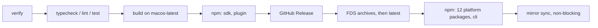

# Release CI

## Report

> Later: `npm-fds-launcher` retired npm platform packages — npm now publishes SDK/plugin + the `@mimo-ai/cli` launcher only; platform binaries are FDS/GitHub archives.

**What was built** — Pushing a `vX.Y.Z` tag on a main commit runs `.github/workflows/release.yml`: verify (tag on main, four package versions equal the tag), the existing typecheck/lint/test workflows via `workflow_call`, a macOS build of 12 archives and 15 npm tarballs, then a publish job in environment `release` that ships npm SDK/plugin → GitHub Release (generated notes, archives only) → FDS archives then `releases/latest` → npm platform packages and `@mimo-ai/cli`, followed by a non-blocking mirror sync. npm publishes through trusted publishing (OIDC) with no stored token. Every publish stage skips work that already landed, so "Re-run failed jobs" resumes a release.

`script/release.ts` replaces the old release, version and publish scripts (root and per-package). `packages/cli/script/build.ts` only builds, with `--archive` for release archives; `MIMOCODE_RELEASE` is gone. The shared setup-bun action now pins Bun from `packageManager` and installs with `bun ci`. CONTRIBUTING documents the procedure and the npm trusted-publisher setup.

**Verification**

- `bun typecheck` (root) — PASS.
- actionlint 1.7.12 over all workflows — PASS (also after the review fix).
- `bun test script/release.test.ts` — PASS, 7 tests / 23 expects (version format, verify against real git fixtures, real SDK/plugin packing).
- oxlint on the new files — 0 errors; 3 `await-thenable` warnings on `await expect(...).rejects`, the pattern used elsewhere in the repo.
- Full `MIMOCODE_VERSION=v0.1.15 bun script/release.ts build` in a throwaway clone with HEAD tagged — PASS: 12 archives and 15 tarballs, checkout clean afterwards; sdk/plugin/cli/platform `package.json` fields match the published 0.1.15 on npm; darwin-arm64 binary is ad-hoc signed like v0.1.15 and prints `0.1.15`.
- Independent review — spec compliance met for T1–T5, no critical findings. Adopted: `release` environment gate, CONTRIBUTING notes on manual start from the tag and one release at a time. Accepted as-is: `npm view` network errors fall through to a failing publish (retry resolves), an already-published GitHub Release is skipped without asset checks, the mirror-sync log prints the `v` prefix.

Not run: a real tag-triggered release, OIDC publication, FDS upload. These need the trusted publishers configured on npmjs.com first.

**Journey log**

1. `bun pm pack` already rewrites `workspace:` and `catalog:` specifiers; only `exports` needs moving from `src` to `dist`, so packing stays in place with a restore in `finally`.
2. v0.1.15 was built on macOS (ad-hoc, linker-signed darwin binaries, clean tarballs); building on `macos-latest` keeps that rather than trusting cross-signing from Linux.
3. Bun's `$.cwd()` mutates the shared shell; tests need `new $.Shell().cwd(dir)`.
4. Publishing SDK/plugin before the binary removes the window where a downloadable binary resolves an unpublished plugin version, without touching runtime code.

## [S1] Problem

Releases run from a maintainer machine through `bun run release`: `script/version.ts` drafts a GitHub Release, `packages/cli/script/build.ts` builds and uploads to GitHub and FDS, and `script/publish.ts` rewrites every package.json, runs a non-frozen install, regenerates the SDK, and publishes 15 npm packages with a long-lived npm token. The process depends on one machine's credentials and state, mixes building with publishing, and publishes `@mimo-ai/plugin` last, after the binary is already downloadable — a fresh binary resolving `@mimo-ai/plugin@<its version>` can hit a version npm does not have yet.

The goal is a CI-only release path that lands before v0.1.16, so later work (retiring npm platform packages around v0.2) only edits CI lists.

## [S2] Design

### Trigger

- The maintainer merges a version-bump PR (cli/sdk/plugin/shared package.json all at the same `X.Y.Z`, SDK regenerated manually as today), then pushes tag `vX.Y.Z` on that main commit. The tag push starts `.github/workflows/release.yml`.
- `workflow_dispatch` with no inputs is kept for reruns when the original run is unavailable; it must be started from the tag ("Use workflow from" → the tag). Within a run, "Re-run failed jobs" is the normal recovery path and reuses the original build artifact.
- One workflow-level concurrency group `release` (no cancellation) serialises releases.

### Jobs

1. **verify** (ubuntu): `bun script/release.ts verify`. Fails unless the ref is a tag matching `vMAJOR.MINOR.PATCH` (no prerelease/leading zeros), HEAD is the tag commit and is reachable from `origin/main`, and `packages/{cli,sdk,plugin,shared}/package.json` versions all equal the tag version.
2. **checks**: the existing typecheck, lint and test workflows gain a `workflow_call` trigger and run against the tag commit.
3. **build** (`macos-latest`, matching how past releases were produced: darwin binaries ad-hoc signed by the native toolchain): `bun script/release.ts build` re-runs verify, builds all 12 targets via `packages/cli/script/build.ts --archive`, compiles SDK/plugin from committed sources with `tsc` (never the SDK generator), packs 15 npm tarballs, writes `dist/release/{archives,npm}/`, then asserts the checkout has no tracked or untracked changes. The directory is uploaded as one Actions artifact.
4. **publish** (ubuntu, environment `release`, `contents: write`, `id-token: write`): downloads the artifact and runs stages in order. Each stage is idempotent so "re-run failed jobs" resumes safely:
   - `npm libs` — `@mimo-ai/sdk`, then `@mimo-ai/plugin`. Publishing these first removes the window where a downloadable binary references an unpublished plugin version.
   - `github` — create release `vX.Y.Z` with `--verify-tag --generate-notes` and only the 12 archives. If a draft exists (earlier partial attempt) upload with `--clobber` and publish it; if a published release exists, skip.
   - `fds` — upload the 12 archives to `releases/vX.Y.Z/`, then write `releases/latest` last.
   - `npm cli` — 12 platform packages, then the `@mimo-ai/cli` wrapper.
   - `script/sync-registry.ts` mirror sync with `continue-on-error`.

### npm publication

- Trusted Publishing (OIDC) only: no `NPM_TOKEN` secret. Each of the 15 packages must have a trusted publisher configured on npmjs.com for repository `XiaomiMiMo/MiMo-Code`, workflow `release.yml`, environment `release`; `bun script/release.ts trust` registers it for every published package with `npm trust github` (npm ≥ 11.19, run once by an owner in a 2FA login session — tokens cannot change package settings). npm CLI ≥ 11.5.1 is required; the job installs `npm@11` and the script asserts the version.
- Every tarball publishes with `--access public --tag latest`. A package whose exact version already exists on the registry is skipped, which makes reruns safe.
- Pack rules: `bun pm pack` resolves `workspace:*` / `catalog:`; the script temporarily rewrites SDK/plugin `exports` from `./src/*.ts` to `./dist/*.{js,d.ts}`, copies `README_npm.md` and `LICENSE`, and restores the original files afterwards. After packing, the tarball's `package.json` must have the expected name/version, no `workspace:`/`catalog:` specifiers, and every export target present in the tarball.

### Secrets

| Name                                                      | Kind                | Purpose                       |
| --------------------------------------------------------- | ------------------- | ----------------------------- |
| `MIMO_FDS_AK`, `MIMO_FDS_SK`                              | repository secret   | FDS upload + public-read ACL  |
| `MIMO_FDS_ENDPOINT`, `MIMO_FDS_BUCKET`, `MIMO_FDS_PREFIX` | optional variables  | Override FDS destination      |
| `GH_TOKEN`                                                | from `github.token` | Release creation and upload   |
| npm                                                       | OIDC                | No secret; configured per pkg |

### Script surface

- `script/release.ts <verify|build|github|fds|npm libs|npm cli>` replaces `script/release.ts`, `script/version.ts`, `script/publish.ts` and `packages/{cli,sdk,plugin}/script/publish.ts`. Version comes from `MIMOCODE_VERSION`. `script/fds-upload.ts` and `script/sync-registry.ts` stay.
- `packages/cli/script/build.ts` no longer uploads anything; `--archive` produces the archives. `MIMOCODE_RELEASE` and `Script.release` are removed.
- `.github/actions/setup-bun` pins Bun via `bun-version-file: package.json` (build.ts refuses any other Bun) and installs with `bun ci`.

### Failure handling

A failed stage stops the job; later channels are not touched. Fix the cause (credentials, trusted-publisher config, network) and "Re-run failed jobs". If artifact content itself is wrong after any channel published, ship a new patch version instead of overwriting.

## [S3] Out of Scope

- Changing npm package scope (platform packages, CLI wrapper behaviour) — PR B.
- Runtime plugin auto-install, debug-agent fixes, plugin examples, Bun type bumps from #2638.
- Automating version bumps, SDK generation, or tag creation.
- Separate npm READMEs for SDK/plugin.

## Tasks

- [x] T1: Rewrite `script/release.ts` with verify/build/github/fds/npm stages and delete the replaced scripts — acceptance: `bun script/release.ts verify` rejects a non-tag/mismatched version; old entry points are gone and nothing references them (covers: S2)
- [x] T2: Strip uploads from `packages/cli/script/build.ts`, add `--archive`, drop `MIMOCODE_RELEASE` — acceptance: host `--single --archive` build produces the archive and touches no remote (covers: S2)
- [x] T3: Pack SDK/plugin from committed sources with a regression test — acceptance: test packs both into a temp dir; tarball exports resolve to files inside the tarball and no `workspace:`/`catalog:` specifiers remain; checkout is clean afterwards (covers: S2; depends: T1)
- [x] T4: Add `release.yml`, `workflow_call` on check workflows, pinned/frozen setup-bun — acceptance: actionlint passes; job graph and permissions match S2 (covers: S2; depends: T1)
- [x] T5: Update CONTRIBUTING with the release procedure and trusted-publisher setup — acceptance: doc describes bump PR → tag push → rerun path and lists secrets (covers: S2; depends: T4)
