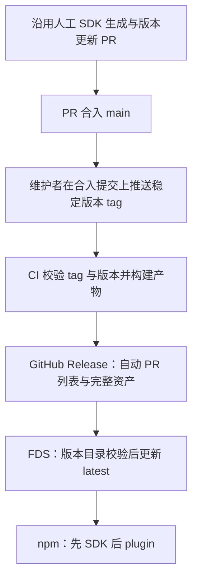

# 发版流程与分发边界

## Report

## [S1] Problem

**SDK 手动生成、版本更新 PR 的现行操作完全不变。** 本方案只把 PR 合入之后的 GitHub Release → FDS → npm 发布接入 tag 触发的 CI，并解除 MiMoCode 启动对同版本 plugin npm 包的隐式依赖。npm 排在 FDS 后面，尚未发布或发布失败时，已发布的 MiMoCode 仍须能正常使用内置功能。

本次交付包含发版分析文档，以及用户随后明确要求的运行时修改：删除 Config/TUI 的自动依赖准备链，并补充插件分发与迁移指引。CI、SDK 人工操作和 npm CLI 弃用发布仍只记录方案，不在本次实施。

## [S2] Design

### 信息依据

- 现行人工操作以维护者本次说明为准：SDK 原本就手动生成，不需要前移、自动化或重新设计。
- **所有脚本分析以 MiMo-Code 主仓为准**，本次检查基线为 `f98dcd1c`。源码中存在的命令不等于维护者当前实际执行了整条命令。
- `mimoapi` 的所有文档和脚本均为历史资料。本次参考其环境注入、凭据分工及历史说明，不沿用它的脚本、路径、私有 plugin、overlay 或内部仓打 tag 步骤。最后一次发版之后已经有过一次面向开源可审计的大调整。
- Desktop 是独立的下游，按自己的 engine pin 随包编译。本次未找到其自动替换引擎的调用链，不新增 `desktop` channel，不安排 Desktop 修改。

### 主仓当前具备什么

| 项目         | 当前主仓事实                                                                                         | 对 CI 接入的意义                                                 |
| ------------ | ---------------------------------------------------------------------------------------------------- | ---------------------------------------------------------------- |
| CI 入口      | `.github/workflows/` 只有 main 的 typecheck、test、lint 及手动触发，没有 release workflow            | 新增稳定 tag 触发的发布流程；普通 main/PR CI 不承担发布          |
| 总发布脚本   | `script/release.ts` 顺序为 version → build → publish → undraft                                       | 不能把它原样塞进 tag job                                         |
| Release 描述 | `script/version.ts` 创建 draft，读 `UPCOMING_CHANGELOG.md`，不存在则写 `No notable changes`          | 新 CI 应使用 GitHub 自动生成的 PR 列表                           |
| 构建与上传   | `packages/cli/script/build.ts` 在 release 模式下同时打包、上传 GitHub、上传 FDS 并写 latest          | 需要让构建产物可复用，上传阶段可单独重试                         |
| npm 总入口   | `script/publish.ts` 遍历修改 package.json、调用非 frozen 安装、再次生成 SDK，再发布 CLI、SDK、plugin | 这些副作用不应进入新 CI；继续消费人工已提交的版本和 SDK 源码     |
| 包级发布     | `packages/{sdk,plugin,cli}/script/publish.ts` 已有打包/发布逻辑和“已发布则跳过”检查                  | 可复用打包规则；现有检查没有核对包内容，不能直接作为可靠续跑契约 |
| FDS          | `script/fds-upload.ts` 提供对象上传和公开读 ACL 设置；build 在缺密钥时跳过 FDS                       | 正式发版不得把缺凭据静默当成功                                   |
| 依赖安装     | `.github/actions/setup-bun/action.yml` 目前运行非 frozen 安装；build 还主动安装跨平台依赖            | 新 CI 必须按 `bun.lock` 准备依赖，不复制这些副作用               |

以上仅描述可调用代码。尤其 `publish.ts` 中的 SDK 生成是新 CI 必须避开的脚本行为，**不是对现行手动 SDK 流程的判断，也不是本方案要求改动 SDK 准备步骤**。

## [S3] Out of Scope

- 本次不修改 CI 或 Desktop，不生成 SDK、不更新产品版本、不推送 tag、不上传或发布包；运行时仅修改 S6 的自动依赖准备及相关错误引导。
- SDK 的人工生成流程保持原样；CI 不代替维护者生成或提交 SDK。
- 不执行 npm registry 的 deprecate 操作；本方案中明确标记 CLI 入口的弃用方向和阶段。
- 不引入 `desktop` channel，不把未复现的用户反馈定性为更新 bug。
- 不接入历史私有 plugin、overlay、内部仓构建或内部仓 tag。
- npm 下载 FDS 二进制的包装器仅比较方案，不作为已选实现。

## [S4] Tag 触发的发版流程

### 操作顺序



SDK、版本 PR、合入方式均沿用现行操作。维护者确认 PR 已合入及该提交检查通过后，才在该合入提交上打 tag；不能误用分支上的合入前提交，也不能在发版过程中补版本提交。例子 `v0.1.99` 仅表示稳定版本 tag 格式。

接入新 workflow 后，维护者推送 tag 即完成发布触发，不再手动运行三段上传脚本。首版流程限定稳定版本逐个发布：上一稳定版本 run 完成、或其失败已处理之后，才发下一个 tag；暂不支持多个版本同时竞争 latest。

### 触发与预检

1. workflow 订阅 `push.tags: ['v*.*.*']`。这是 glob，job 仍须严格验证 `vMAJOR.MINOR.PATCH`，排除预发布后缀、额外字段和前导零。删除 tag 的事件不能发布。
2. 完整获取 tag 和 main 历史，解引用 tag 到 commit，checkout 该 SHA。确认 SHA 属于 `origin/main`，所有后续阶段固定使用它，不能重新 checkout 当时最新的 main。
3. tag 去掉 `v` 后必须等于 `packages/cli`、`packages/sdk`、`packages/plugin` 的版本；`packages/shared` 及 `bun.lock` workspace 版本按现行统一版本规则一致。根 package.json 没有版本，不新增。禁止 `MIMOCODE_BUMP`、`MIMOCODE_SKIP_VERSION_CHECK` 绕过检查。
4. tag 不会自动触发现有仅监听 main 的三个 workflow。发布 job 必须依赖针对该 SHA 的 typecheck、lint、现有分片测试及其隔离测试，或严格核对这些指定检查在该 SHA 的成功结果；不能仅依据 PR 合入前的一次绿灯。
5. 按根 package.json 精确固定 Bun，使用 `bun ci`。跨平台构建可用 Bun 支持的 `--os='*' --cpu='*'` 配合 frozen 安装准备锁定依赖，再让 build 跳过安装；需以全部目标构建成功验证，不能仅假定 host 依赖足够。
6. CI 不调用含 SDK codegen 的 `packages/sdk/script/build.ts`；npm SDK 产物只对已提交源码运行 TypeScript 编译。构建后检查跟踪文件无变化，禁止 CI 改版本、改锁或提交代码。

### 构建与发布阶段

| 阶段           | 输入和行为                                                                                      | 成功条件                                                                                         |
| -------------- | ----------------------------------------------------------------------------------------------- | ------------------------------------------------------------------------------------------------ |
| 构建           | 公共源码的 tag SHA、锁文件、固定工具链；编译 CLI、已提交 SDK 和 plugin，预先打好 npm tarball    | 保存 tag、SHA、工具链版本、文件清单与摘要；覆盖主仓现有 12 个 CLI 目标，名称和压缩格式兼容安装器 |
| GitHub Release | 已存在的 tag；自动生成 notes；先建 draft、上传并核对全部资产，再转正式                          | 用户看到包含完整 PR 列表和可下载产物的 Release，然后才进入 FDS                                   |
| FDS            | 复用完全相同的 CLI 压缩包，上传 `releases/v<version>/<filename>`                                | 全部对象公开可读且摘要一致后，写 `releases/latest` 为裸版本号，再回读验证                        |
| npm            | 复用预先打好的 tarball，先发 `@mimo-ai/sdk`，确认 registry 可读取该版本，再发 `@mimo-ai/plugin` | 包名、版本、导出文件、依赖版本和 registry integrity 一致；过渡期 CLI 策略见 S5                   |

GitHub Release 转正式、FDS 更新 latest 都可以发生在 npm 完成之前。这是有意保留的发布顺序；其前提是 S6 的内置功能不再依赖同版本 npm 包。npm 失败时保留已经成功的 GitHub/FDS 发布，CI 明确显示 npm 阶段失败，使用同一 tag 继续发布 npm。

`build.ts` 还会获取 models.dev 数据。一次发版只获取一次快照，记录其来源和摘要并供所有目标复用；不能让重试时变化的在线数据悄悄改变同版本产物。这个构建输入与人工 SDK 生成无关。

主仓当前把压缩打包也放在 `Script.release` 分支，不能仅删除环境变量就假定已经得到纯构建流程。后续实现应分开构建/压缩与外部上传，保留资产命名。`MIMOCODE_RELEASE` 当前按字符串 truthiness 解释，设置为 `0` 也是真；纯构建不能依赖这种写法关闭上传。

### Release notes

使用 GitHub 自动生成 release notes 的能力，保留 PR 标题、作者、链接、贡献者与比较链接。通过 `gh release create --verify-tag --generate-notes` 创建，显式指定仓库；有上一稳定版本时指定 `--notes-start-tag`。官方参数见 [gh release create](https://cli.github.com/manual/gh_release_create)。

基线选择已经正式发布、在目标提交祖先链上、版本低于目标的最近稳定 tag；首次发布没有基线时省略该参数。不要根据当前 main 头或创建日期猜范围。把选择的基线和生成的正文保存到本次产物清单，重试复用，避免发布期间有新 PR 合入导致正文漂移。

无需恢复历史人工重写双语分类 notes 的流程；本任务要求的是自动 PR 列表。`UPCOMING_CHANGELOG.md` 不再作为 CI 必备输入，也不在失败时用 `No notable changes` 冒充已成功生成。GitHub 自动列表覆盖关联的合入 PR；确有直接提交时仍可由 Full Changelog 查看，不能承诺所有提交都有 PR 条目。

### 凭据与环境注入

| 用途     | 新 CI 契约                                                                                                                                                                    |
| -------- | ----------------------------------------------------------------------------------------------------------------------------------------------------------------------------- |
| GitHub   | 发布 job 使用 `contents: write`，`GH_TOKEN` 来自该 run 的 `github.token`，`GH_REPO` 来自固定目标仓库；检查所需额外读取权限仅给相应 job                                        |
| FDS      | 沿用主仓 `MIMO_FDS_AK` / `MIMO_FDS_SK`，只在上传 job 注入；凭据需有对象写入及设置公开读 ACL 的权限，缺失直接失败                                                              |
| FDS 布局 | 可配置 `MIMO_FDS_ENDPOINT` / `MIMO_FDS_BUCKET` / `MIMO_FDS_PREFIX`；上传地址与安装器的读取地址需指向同一布局，上传域名不等于下载域名                                          |
| npm      | 首选按 npm 当前支持要求配置 trusted publishing/OIDC 并固定 Node/npm；如使用 token，必须通过 npmrc/认证 action 将 secret 接到 registry，单独设置 `NPM_TOKEN` 不代表 npm 已登录 |
| 版本     | CI 从已校验 tag 注入 `MIMOCODE_VERSION`、`MIMOCODE_CHANNEL=latest`；不能依赖 detached HEAD 的分支推断                                                                         |

发布不需要开发者机器的 `.env`、私人 npmrc 或内部仓权限。凭据只授权发布阶段，构建输入全部来自公开源码和声明的依赖。接入前验证 runner 的 GitHub、FDS 和 npm 网络可达性及上传权限；这是发布环境准备，不改变 SDK 人工操作。

### 失败和续跑

- 同一 tag 不允许并发发布，`cancel-in-progress: false` 避免取消正在上传的 run。跨版本遵循上述逐个发布规则；不能把 GitHub 全局 concurrency 的单个 pending 槽当成保证不丢任务的发布队列。
- 每个阶段独立记录完成状态。预检或构建失败不产生发布；GitHub 失败不进入 FDS；FDS 失败不更新 latest、不进入 npm；npm 失败不回滚已成功的二进制渠道。
- 在 GitHub 保存构建清单、CLI 压缩包和 npm tarball，重跑优先下载这些已保存产物。资产存在时校验内容；不能直接用当前 `--clobber` 覆盖已公开版本，也不能在不同源码上复用 tag。
- npm 已有相同 `name@version` 时比较 `dist.integrity` 与待发布 tarball，相同才跳过，不同则停止。查询认证失败、网络错误不能当成“尚未发布”；`npm view` 任意非零即尝试发布的现有判断需要收紧。
- latest 只能前进：续跑旧版本可补齐缺失的 npm 包，不得把 GitHub latest、FDS latest 或 npm latest 指回旧版本。正常发布 tarball 与移动 npm dist-tag 分步处理，避免默认 `npm publish --tag latest` 隐式回退。
- 保留已上传的版本目录；不因某一渠道失败删除 tag、取消 npm 发布或覆盖同版本内容。若内容本身错误，走新修复版本。国内镜像同步是可重试的后续操作，不决定官方 registry 发布成功；现有 `sync-registry.ts` 的 CLI/platform 列表需随 S5 收敛，不能当成 SDK/plugin 已验证。

## [S5] npm CLI 入口弃用

**决定：npm 的 CLI 安装入口进入弃用计划；长期仅维护 `@mimo-ai/sdk` 和 `@mimo-ai/plugin` 两类开发包。** CLI 本身继续作为 GitHub/FDS 二进制分发，不废弃 `mimo` 命令或核心产品。本次只在方案中标记弃用，未修改 npm registry 状态。

| 阶段          | CLI npm 行为                                                                                                           | 必须先满足                                                                   |
| ------------- | ---------------------------------------------------------------------------------------------------------------------- | ---------------------------------------------------------------------------- |
| 0.1.x 过渡    | 暂保留现有 CLI wrapper 和平台包发布；文档/发版说明引导改用官方安装器，实施迁移时为这些 CLI 包设置 npm deprecation 提示 | 明确公告，验证现有 npm 用户迁移到官方安装目录后的 PATH 和升级路径            |
| 目标约 v0.2.0 | 为 `@mimo-ai/cli` 发布一次只含 package.json、README、LICENSE 的占位包；停止平台 npm 二进制包的新版本发布               | 在该版本准备 PR 中确认迁移已完成；未满足就推迟占位包，不能自动按版本阈值切空 |
| 后续稳定版本  | npm 正常发布白名单只含 SDK、plugin；占位包不必每版跟随                                                                 | 发布脚本与镜像同步脚本均不再遍历 CLI 平台包                                  |

占位包没有 `bin`、安装脚本、运行代码、dependencies 或 optionalDependencies。README 和 npm deprecation 提示推荐从 [MiMoCode 官方安装说明](https://mimo.xiaomi.com/coder)安装二进制；不要在 postinstall 中自动执行下载器。已有 CLI/npm 平台版本保留，不做 unpublish。该占位版本也应有 registry deprecation 提示。

需要明确告知用户：显式把全局 npm CLI 升到占位版本会移除原有命令入口，不能把这当成无影响更新。当前自动升级只应用被判为 patch 的版本，但用户仍可能手动 upgrade/npm update；占位包必须先公告迁移。迁移先安装并验证官方二进制，再移除旧 npm 安装并检查命令解析位置；SDK 的 `createOpencode` server helper 也会通过 PATH 启动 `mimo`，其使用者仍需单独安装 CLI。

SDK/plugin tarball 检查应证明：包内导出路径实际存在、`workspace:*` 和 `catalog:` 已转换为可公开解析的依赖、plugin 指向本次准备的 SDK 版本，两个包的说明分别解释 API/插件用途。当前两者复制同一份 CLI 导向的 `README_npm.md`，后续应拆成各自说明，避免继续推荐已弃用的 npm CLI 入口。

“npm wrapper 下载 FDS 二进制再启动”暂不采用。它仍需要维护平台/ABI 选择、下载校验、缓存、代理、PATH、卸载和版本固定；当前升级器还会按 npm 安装路径走 npm feed，与直接下载二进制的更新归属不一致。只有决定继续维护 npm CLI 入口时，才值得单独设计这条路径。

## [S6] 为什么会调用 npm，以及如何不依赖它启动

### 修改前的调用链

```text
Config.loadInstanceState（普通配置目录，非 modelsOnly）
  或 TuiConfig.layer（配置了外部 TUI plugin 时）
  → Npm.install(dir, { add: [{ name: "@mimo-ai/plugin", version }] })
  → import("@npmcli/arborist")
  → Arborist.reify({ add, save: true, saveType: "prod" })
  → 配置目录中的 package.json / package-lock.json / node_modules
```

修改前基线的 [Config](../../../packages/cli/src/config/config.ts) 有后台安装，[TUI Config](../../../packages/cli/src/cli/cmd/tui/config/tui.ts) 有依赖准备，两者调用 [Npm 实现](../../../packages/cli/src/npm/index.ts)。这里使用的是 npm 的 JS 库 `@npmcli/arborist`，**不要求调用系统的 npm 可执行文件**。它负责解析、下载和落盘依赖；`ignoreScripts: true` 只是不运行安装脚本，不表示不会联网。

自动补装的作用是给用户配置目录中直接加载的插件/工具源码提供模块解析环境。它不是“插件系统必须先从 npm 下载才能存在”。普通 Config 即使没有外部插件也会安排安装；TUI 只在其外部 plugin 配置非空时安排。安装失败可能只留下警告，并不保证所有内置功能因此失败，但会产生无必要的下载和本地插件解析问题。

修改前的安装身份解析对合法 release semver 请求同版本 SDK；本地或非 semver 身份不固定版本。因此 FDS 先公开一个尚未发 npm 的版本时，干净目录可能请求尚不存在的 `@mimo-ai/plugin@<version>`。已有缓存可能掩盖问题，不能用开发机“启动正常”证明发版顺序安全。

### 哪些已经内置

| 能力                                                          | 当前来源                                                                | 是否需要启动时补装 plugin npm 包               |
| ------------------------------------------------------------- | ----------------------------------------------------------------------- | ---------------------------------------------- |
| 插件管理、hook 执行、工具注册                                 | 引擎源码的 plugin、tool registry、TUI runtime                           | 不需要                                         |
| 官方内置插件                                                  | 服务端 `INTERNAL_PLUGINS` 静态导入；TUI `INTERNAL_TUI_PLUGINS` 静态导入 | 不需要；第三方源码依赖也是构建时依赖           |
| 宿主用到的 SDK 运行值                                         | 例如 matcher 导入 `BUILT_IN_AGENTS`、宿主创建 SDK client                | 通过 workspace 依赖进入 CLI/Node 构建          |
| 用户松散源码插件中的 `import { tool } from '@mimo-ai/plugin'` | 运行时从该源码所在目录解析模块                                          | 目前受隐式安装帮助；应改为开发者自行准备或打包 |

`@mimo-ai/plugin` 并非纯类型包：它导出 `tool()`、`tool.schema`（Zod）和 `BUILT_IN_AGENTS` 等运行值；`/tui` 当前主要提供类型。简单把所有 import 改成 `import type` 不成立，也无需复制一份插件系统进核心。所需核心功能已经在构建依赖图里。

### 本次实现边界

1. **取消 Config/TUI 的自动目录依赖准备链路**，不再注入 plugin SDK、不按引擎版本联网补包。只删除 `add` 参数仍会恢复旧清单依赖，因此不足以满足这条边界；对应等待和文件加载重试链也要一起检查。
2. 内置插件继续静态导入并随 CLI/Node 产物分发；未来官方插件如果属于产品必备功能，遵循同样方式。不开启默认 npm 插件清单来替代内置。
3. 插件/自定义工具开发者自行取得开发依赖。类型使用 `import type`；实际用到的 runtime helper、业务依赖打进分发产物，或由开发者明确准备本地依赖。漏依赖时给出可定位的模块错误，不静默补装。
4. TUI 插件不能无差别内联所有依赖：Solid/OpenTUI 的宿主共享运行时保持 external，由现有 `@opentui/solid/runtime-plugin-support` 桥提供，避免 renderer、owner、signal/store 出现两份实例。普通业务依赖和 SDK helper 才是可打包部分。
5. 不自动删除旧配置目录中的 package.json、锁文件或 node_modules，无法可靠区分它们由谁维护。停止 bootstrap 后不再主动恢复其中的 SDK；旧的松散插件仍可用既有依赖，开发者按自身需求迁移或清理。
6. 保留用户明确配置的 npm 插件按需安装：`resolvePluginTarget → Npm.add` 是独立路径。插件自己声明的传递依赖仍可能包含 SDK，这是该外部插件的分发选择，不应变成 MiMoCode 内置功能的依赖。

迁移说明放在 `docs/plugins.md`，中英文 README 增加开发插件的 details，默认推荐打包式分发。提供 `examples/plugins/greeting` 开发项目，包含公开 SDK 开发依赖、类型检查、build、watch 和部署说明；用户在自己的项目初始化锁文件，后续用 frozen 安装。

用 `mimo debug agent build --tool greet --params '{"name":"Example"}'` 直接验证注册工具，结果为 `Hello, Example!`。调试入口使用完整的已注册工具集合，保留 model/agent/permission 过滤但不应用 GPT 顶层工具压缩，并通过 AppRuntime 执行工具的 Effect，而不是序列化 Effect 对象。这个修正服务于实际可运行的插件开发路径。

缺少运行依赖的本地插件保留原始模块错误，并给出“自行准备依赖或打包后加载”的可操作提示；不对所有用户增加启动弹窗。已有自包含插件、内置插件及显式 npm 插件安装方式不变。

不建议为所有第三方源码额外实现“将 `@mimo-ai/plugin` 重定向到宿主模块”的透明加载器。它需要同时处理 Bun 编译 CLI、Node ESM、包子路径、版本兼容和 TUI 共享实例，范围远大于取消自动 bootstrap，也不符合开发者自行打包的方向。

**不删除整个 Npm 服务。** 主仓还有非内置 provider 的 `Npm.add(model.api.npm)`，以及 formatter/LSP 的 `Npm.which()`（缓存缺失时会安装）。已内置 provider 走 `BUNDLED_PROVIDERS`，不用这条动态安装路径。本方案保证“内置插件和默认运行不依赖 plugin npm 包”，不承诺所有外部插件、provider、语言工具或模型服务都无需网络。

本次实现取代 [plugin-sdk-npm-version](plugin-sdk-npm-version.md) 中“继续自动安装但修正 npm 版本选择”的运行时策略；那份文档保留为历史交付记录。删除失去调用方的 `PluginSdkNpmVersion`，安装身份本身仍供其他功能使用。

## [S7] Desktop 核查结论

检查 Desktop `2955b9ad` 及其 engine pin `6babeb0b`：`scripts/engine/build-engine-node.ts` 将 `desktop-<pin7>` 和 `channel=latest` 注入 Node 构建；`electron.vite.config.mjs` 将产物拷为 `node.mjs`，`electron/lib/engine/index.ts` 在 Electron 主进程中动态导入并调用 `Server.listen`。它并非启动独立的 `mimo` 二进制。

主仓自动升级链为 `tui/thread.ts → worker.checkUpgrade → cli/upgrade.ts`。在检查的 Node 入口及 Desktop 中未找到这条自动调用，也未找到 Desktop 调用 `/global/upgrade` 的代码。非 semver 的 `desktop-<pin7>` 若误入版本分类，目前还会被 semver 拒绝；这不作为正式保护设计。

`/global/upgrade` 接口确实存在，且未用 channel 区分更新归属，但“可调用接口”不能证明用户报告的事件已经发生，更不能证明它替换了内嵌 Node 产物。**按本次决定跳过 Desktop 修改，不新增 desktop channel。** 后续只有拿到具体版本、调用日志及被改文件证据，再按真实触发原因调查；Desktop 自身的整包 updater 不受本方案影响。

## [S8] 后续实现顺序与验收

本节区分本次运行时实现与后续 CI 工程验收；完成情况以 Report 为准。

| 顺序      | 工作                                   | 验收条件                                                                                                                                                         |
| --------- | -------------------------------------- | ---------------------------------------------------------------------------------------------------------------------------------------------------------------- |
| 1（本次） | 解除自动 plugin SDK 安装并提供迁移指引 | 干净配置、旧自动生成清单、开发者自备依赖三类环境；普通 Config/TUI 加载不再需要 Npm 安装服务；保留自包含插件、内置插件和显式 npm 插件功能；缺依赖的文件插件有引导 |
| 2         | 固定发布输入并拆开脚本副作用           | 保持 SDK 人工步骤原样；CI 只编译已提交内容；版本/锁/tag 不一致即失败，全部目标及 tarball 生成后源码仍干净                                                        |
| 3         | 接入 tag workflow                      | 合法 main 稳定 tag 触发，非法 tag/非 main 提交不能发布；检查完成后依次 GitHub → FDS → npm，notes 范围正确                                                        |
| 4         | 验证延迟与续跑                         | 故意让该版本 SDK/plugin 在 npm 不存在或 registry 不可达，从已构建 FDS 压缩包启动，内置功能正常且不尝试获取该 SDK；再恢复 npm 完成续跑，无覆盖和 latest 回退      |
| 5         | 公告 npm CLI 迁移                      | README、Release notes 和 registry deprecation 文案一致；在目标约 v0.2.0 的准备 PR 确认占位策略，tarball 无 CLI 内容，SDK/plugin 发布持续可用                     |

插件验收使用真实构建产物和隔离配置目录，不能靠测试中的 noop Npm mock 得出“不联网”。覆盖类型导入、打包的 `tool`/Zod、缺依赖的本地工具，以及 TUI slot 渲染、响应式更新和 cleanup。默认内置 provider 可使用本地测试服务，避免把模型服务网络失败误判成插件问题。npm 失败恢复至少覆盖 SDK 已发/plugin 未发、已有版本内容不同、认证失败和镜像延迟。

## 参考

- 当前主仓：[release](../../../script/release.ts)、[version](../../../script/version.ts)、[publish](../../../script/publish.ts)、[CLI build](../../../packages/cli/script/build.ts)、[FDS uploader](../../../script/fds-upload.ts)、[SDK build](../../../packages/sdk/script/build.ts)、[npm 包级发布](../../../packages/plugin/script/publish.ts)、[CI setup](../../../.github/actions/setup-bun/action.yml)。
- 内置来源：[服务端插件](../../../packages/cli/src/plugin/index.ts)、[TUI 插件](../../../packages/cli/src/cli/cmd/tui/plugin/internal.ts)、[插件 helper](../../../packages/plugin/src/tool.ts)、[工具注册](../../../packages/cli/src/tool/registry.ts)、[provider](../../../packages/cli/src/provider/provider.ts)、[Node 构建](../../../packages/cli/script/build-node.ts)。
- 历史资料，仅辅助理解：[github-release.md](https://git.n.xiaomi.com/mimo-innovation/mimoapi/-/blob/3b6a8f62092c496af2778d7ffc213d9e4f73cc19/docs/github-release.md)、[release-handover.md](https://git.n.xiaomi.com/mimo-innovation/mimoapi/-/blob/3b6a8f62092c496af2778d7ffc213d9e4f73cc19/docs/release-handover.md)、[npm-publish.md](https://git.n.xiaomi.com/mimo-innovation/mimoapi/-/blob/3b6a8f62092c496af2778d7ffc213d9e4f73cc19/docs/npm-publish.md)。不据此推断当前主仓行为。

## Tasks

- [ ] T1: 形成 PR → tag → CI 流程 — acceptance: 主仓为脚本依据，SDK 人工流程不变，写清自动 notes、发布顺序、凭据和失败续跑 (covers: S2,S4)
- [ ] T2: 明确 npm CLI 弃用 — acceptance: 约 v0.2.0 占位包、迁移前置条件与 SDK/plugin 保留范围可审查 (covers: S5)
- [ ] T3: 分析 npm JS 调用及内置功能边界 — acceptance: 说明 Arborist 调用原因、已内置能力、去除 bootstrap 的范围，以及 npm 尚未发布时的运行验收 (covers: S6,S8)
- [ ] T4: 核查 Desktop 反馈 — acceptance: 提供下游真实构建/调用证据，未发现自动触发则不新增 channel、不设修复任务 (covers: S7)
- [ ] T5: 校验并独立审查交付 — acceptance: 相关测试、类型检查、文档和差异检查通过，独立审查覆盖事实、行为和约定，Report 记录证据 (covers: S2; depends: T1,T2,T3,T4,T6,T7)
- [ ] T6: 删除 Config/TUI 自动安装及等待链 — acceptance: 无需 Npm 安装服务即可加载两类配置，不生成或恢复 SDK 依赖，删除死版本选择器，保留显式 npm 加载 (covers: S6,S8; depends: T3)
- [ ] T7: 添加回归验证和可运行插件开发项目 — acceptance: 自包含插件可加载，现有清单保留，缺依赖提示正确；中英文 README details 可发现开发/构建/部署说明；普通及 Codex 工具模式均能通过 debug 命令实际执行示例 (covers: S6,S8; depends: T3)
