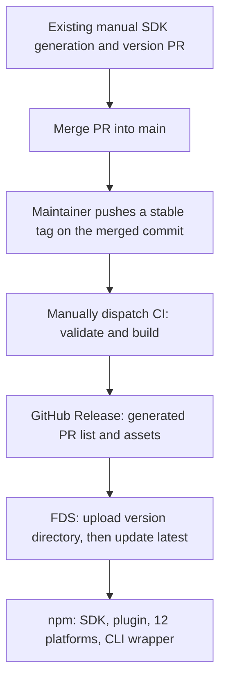

# Release Process and Distribution Boundaries

## Report

**What was built** — The release workflow accepts an existing stable tag through manual dispatch; the automatic tag trigger remains commented out. After validating the fixed commit and manually prepared versions, CI runs the existing checks, compiles committed sources, and publishes to GitHub Releases (with an automatically generated PR list), FDS, and npm in that order. The current npm scope remains 15 packages: SDK, plugin, 12 platform packages, and the CLI wrapper. S5 describes the future migration to two packages. No release workflow, tag creation, or remote publication was initiated during this delivery.

Config/TUI no longer install configuration-directory dependencies automatically, so built-in functionality does not wait for a matching plugin SDK version on npm. Explicitly configured npm plugins remain supported. A bundled-plugin development project, bilingual README details, and migration guidance are included. The debug command executes the example in both normal and Codex tool modes and rejects invalid arguments. Manual SDK generation is unchanged. Desktop was not modified, and no new channel was added.

**Verification** — All commands and checks below completed, and their results were inspected:

- Repository root: `bun ci` — PASS; dependencies installed from the existing lockfile without changing it.
- Repository root: `bun typecheck` — PASS across all workspaces and release scripts.
- `bun test script/release/release.test.ts` — PASS, 19 tests and 53 assertions. Local Git/CLI fixtures cover stable tags, version preparation, the complete 15-package set, GitHub commands, publication order, and stopping on failure. No real publication occurred.
- In `packages/cli`: `bun test test/cli/debug-agent.test.ts test/config/plugin-dependencies.test.ts test/plugin/bundled.test.ts --timeout 30000` — PASS, 9 tests and 40 assertions.
- In `packages/cli`: `bun test test/config/config.test.ts test/config/tui.test.ts test/config/plugin-dependencies.test.ts test/plugin/bundled.test.ts test/plugin/loader-shared.test.ts test/cli/debug-agent.test.ts test/cli/tui/plugin-*.test.ts --timeout 30000` — PASS, 171 tests and 4 platform-specific skips. The later debug-argument validation change was reverified by the preceding command; the other runtime code did not change afterward.
- In `packages/cli`, isolated: `bun test test/provider/refresh.test.ts --timeout 30000` — PASS, 6 tests and 28 assertions.
- Example project: `bun run typecheck && bun run build && bun pm pack --ignore-scripts --dry-run` — PASS. The package contains package.json, README, and dist/server.js with its runtime dependencies bundled. Real SDK/plugin compile-and-pack checks also passed without running SDK code generation.
- Host build: `bun packages/cli/script/build.ts --single --skip-install --archive` — PASS with a local models fixture and the test identity `0.0.0-unpublished`, producing a macOS arm64 binary and archive. The actual binary loaded the extracted example package in an isolated directory; `debug agent build --tool greet --params '{"name":"Example"}'` returned `Hello, Example!` without creating node_modules. The CLI subprocess tests above cover the final argument-validation behavior.
- actionlint 1.7.11 — PASS for all workflows and for a validation-only input with the tag trigger uncommented. Prettier, relative documentation links, spec references, and `git diff --check` — PASS.
- Explicit absolute-path `oxlint --no-ignore --disable-nested-config -c` over all changed TS/JS files — PASS, 108 warnings and 0 errors. PRE-EXISTING `WORKTREE-LINT`: plain `bun lint` ignores paths under `.worktrees`; an explicit configuration and absolute paths avoid this environment issue.
- Independent review of `f98dcd1c..a33d7a62` — PASS, with no remaining blockers for spec compliance, correctness, or codebase consistency.

The full 12-platform build and real GitHub/FDS/npm publication were not run. At the user's request, those checks remain for the maintainer's decision to start release CI.

**Journey log** —

1. Manual SDK generation was already the established process. Historical internal documents only informed environment conventions; the main repository remains authoritative for scripts.
2. Automatic installation existed to prepare dependencies for loose plugin source files. Required host functionality was already bundled, so the change removes that bootstrap and provides a bundled development path.
3. Running the example exposed a debug command that did not execute its Effect and hid custom tools. Independent review also identified missing argument validation. Regression tests cover all three issues.
4. The release path was kept appropriate for infrequent releases: straightforward sequencing and clear errors, with partial publication handled by a maintainer rather than a general remote recovery protocol.

## [S1] Problem

**The existing manual SDK-generation and version-update PR steps remain unchanged.** This design moves the post-merge GitHub Release → FDS → npm publication steps into CI for a selected tag and removes MiMoCode startup's implicit dependency on the matching plugin npm package. npm follows FDS, so a released MiMoCode binary must retain its built-in functionality while npm publication is pending or has failed.

This delivery includes release CI and scripts, the release procedure, removal of Config/TUI dependency preparation, and a runnable plugin development project. CI is implemented without starting a release: manual dispatch is available in the workflow definition, and the stable-tag trigger remains commented out. Manual SDK preparation is unchanged; an npm CLI placeholder around v0.2.0 remains future work.

## [S2] Design

### Sources of truth

- The maintainer's description is authoritative for current manual operations: SDK generation was already manual and does not need to move, become automated, or be redesigned.
- **All script analysis uses the MiMo-Code main repository**, inspected at baseline `f98dcd1c`. A command's presence in source does not establish that maintainers currently execute that entire command sequence.
- All `mimoapi` documents and scripts are historical material. They inform environment injection, credential ownership, and historical context; their scripts, paths, private plugins, overlays, and internal-repository tagging steps are not carried forward. A substantial change for open-source auditability already occurred after the last release.
- Desktop is a separate downstream consumer that builds its pinned engine into the application. No call chain automatically replacing that embedded engine was found. This task adds no `desktop` channel and schedules no Desktop changes.

### Main-repository capabilities before this change

| Area                    | Baseline behavior                                                                                                                 | Implication for CI                                                                  |
| ----------------------- | --------------------------------------------------------------------------------------------------------------------------------- | ----------------------------------------------------------------------------------- |
| CI entry points         | `.github/workflows/` contains main-branch typecheck, test, lint, and manual triggers, but no release workflow                     | Add publication for stable tags; ordinary main/PR checks do not publish             |
| Release entry point     | `script/release.ts` runs version → build → publish → undraft                                                                      | Do not put the old entry point unchanged into a tag job                             |
| Release description     | `script/version.ts` creates a draft, reads `UPCOMING_CHANGELOG.md`, and falls back to `No notable changes`                        | Use GitHub's automatically generated PR list                                        |
| Build and upload        | In release mode, `packages/cli/script/build.ts` builds, uploads to GitHub and FDS, and updates latest                             | Make build outputs reusable and uploads independently invocable                     |
| npm entry point         | `script/publish.ts` rewrites package.json files, runs a non-frozen install, regenerates SDK sources, and publishes CLI/SDK/plugin | Keep these side effects out of CI; consume committed versions and SDK sources       |
| Package publication     | `packages/{sdk,plugin,cli}/script/publish.ts` contain packaging, publishing, and already-published checks                         | Reuse packaging rules; coordinate the normal order through the new root entry point |
| FDS                     | `script/fds-upload.ts` uploads objects and sets public-read ACLs; build skips FDS when keys are absent                            | Missing credentials must not silently count as a successful release                 |
| Dependency installation | `.github/actions/setup-bun/action.yml` uses a non-frozen install; build also installs cross-platform dependencies                 | Prepare dependencies from `bun.lock` with frozen installation                       |

These observations describe callable code only. In particular, the SDK generation in `publish.ts` is a script behavior the new CI must avoid; **it does not redefine the existing manual SDK process or require changes to SDK preparation**.

## [S3] Out of Scope

- Starting release CI, changing Desktop, generating SDK sources, bumping product versions, pushing tags, or uploading/publishing packages during this task. Runtime changes are limited to S6's dependency preparation and plugin development/debugging paths.
- Replacing manual SDK generation or committing generated SDK changes from CI.
- Executing npm registry deprecation. This document records the CLI-entry retirement direction and stages.
- Adding a `desktop` channel or treating an unconfirmed report as a proven update bug.
- Integrating historical private plugins, overlays, internal builds, or internal-repository tags.
- Implementing an npm wrapper that downloads an FDS binary. It is considered as an option, not selected here.

## [S4] Releasing a Selected Tag

### Normal path



This change retains the existing **15 npm packages**: `@mimo-ai/sdk`, then `@mimo-ai/plugin`, then 12 platform binary packages, and finally the `@mimo-ai/cli` wrapper. S5 describes the future two-package migration; publication scope does not change here.

Releases are infrequent and initiated by a maintainer. This implementation provides the normal sequence and clear failures, without automatic cross-channel recovery, draft backups, remote artifact reconstruction, or a general race-handling framework.

### Starting a release

1. Merge the workflow and release scripts into main. Older tags that do not contain these files cannot use this process.
2. Configure the three repository secrets listed below.
3. Follow the existing manual SDK-generation, version-update PR, and merge process. Create and push a stable tag on the merged commit; do not add version commits or regenerate the SDK during publication.
4. In **Actions → release → Run workflow**, select main and enter the existing tag. Equivalent command: `gh workflow run release.yml --ref main -f tag=v0.1.99`. This is an example version; the command was not executed during delivery.
5. `push.tags: ['v*.*.*']` is written in `release.yml` but remains commented out. Uncomment and merge it only when automatic releases are desired. Pushing a tag alone does not currently start publication.

The initial workflow supports only `vMAJOR.MINOR.PATCH` stable versions. Prerelease suffixes, build metadata, leading zeros, and missing components are rejected. The glob only filters events; both manual and automatic entry points validate the stable version.

### Build inputs and checks

- Fetch complete tag/main history, dereference the tag, and verify that its commit belongs to `origin/main`. Pin every check and build to that SHA rather than following a later main head.
- The tag without `v` must match the CLI, SDK, plugin, and shared package.json versions and their `bun.lock` workspace versions. The root package.json has no version; do not add one. Reject environment variables that request a version bump or bypass validation.
- Reuse existing typecheck, lint, sharded tests, and isolated tests. Release-script tests also run in the regular test workflow. Pre-merge PR checks alone are insufficient.
- Pin Bun through packageManager and install with `bun ci`. The repository currently specifies `bun@1.3.14`; setup-bun reads that exact value through `bun-version-file: package.json`. Both release preflight and CLI compilation enforce it. The broader caret check in shared script metadata does not override these exact release checks. Cross-platform builds use `bun ci --os='*' --cpu='*'`, followed by CLI build with `--skip-install --archive`.
- Use the latest patch of Node 24 LTS in release jobs (`node-version: "24"`, `check-latest: true`). Node supplies npm and supporting tooling; the pinned Bun produces the compiled binaries and npm tarballs. The Node 22 TypeScript configuration and type definitions describe a compatibility baseline, not a requirement to run CI on an old Node 22 patch. Bun upgrades remain deliberate repository changes because its runtime is embedded in compiled CLI binaries.
- Compile committed SDK sources with TypeScript; **do not invoke the SDK build script that regenerates them**. Do not change versions, lockfiles, or create commits. Check that tracked source remains clean after building.
- Save one models.dev snapshot for all targets in a build. Record the version, SHA, file inventory, and local digests in `dist/release/manifest.json`, and hand these to the publishing job with the archives, npm tarballs, and snapshot. The manifest checks that jobs use the correct complete build output; it is not a remote recovery protocol.

### Verified version choices

Actual dependency and tool versions were checked against their registry or upstream tags. Example package versions such as `1.0.0` and release fixtures such as `0.1.99` are synthetic examples, not dependency recommendations.

| Component      | Choice and evidence                                                                                                                                                                                                                          |
| -------------- | -------------------------------------------------------------------------------------------------------------------------------------------------------------------------------------------------------------------------------------------- |
| Bun runtime    | `1.3.14`, already pinned by the repository's packageManager; the upstream `bun-v1.3.14` release exists and is stable                                                                                                                         |
| Bun types      | Align the root catalog and standalone example to `@types/bun@1.3.14`; npm metadata declares its exact dependency on `bun-types@1.3.14`. The lockfile records those registry integrity values. Workspace consumers retain `catalog:` bindings |
| TypeScript     | `5.8.2`, the repository's existing compiler version, verified on npm. `@types/bun@1.3.14` declares a TypeScript baseline of `5.3`; the example is checked with the repository compiler                                                       |
| Plugin SDK     | `@mimo-ai/plugin@0.1.15`, matching the repository package and the published npm version; its `PluginModule` and tool exports were inspected                                                                                                  |
| CI Node        | Node 24 LTS with current patch resolution; the official release schedule identifies 24 as LTS at verification time. Node is not used to pin Bun's compilation runtime                                                                        |
| GitHub Actions | Verified upstream major tags: `actions/checkout@v6`, `actions/setup-node@v6`, `actions/upload-artifact@v7`, `actions/download-artifact@v8`, `actions/cache@v5`, and `oven-sh/setup-bun@v2`                                                   |

When upgrading Bun, update the runtime pin, root type catalog, and example's type dependency together, refresh the targeted lock entries, and verify with `bun ci` and typechecking. This change leaves the runtime at `1.3.14` and updates only its type packages from `1.3.11`.

### Four script stages

The maintainer entry point is `bun script/release/index.ts --stage build|github|fds|npm`; the root `bun run release` package command invokes the same module. `MIMOCODE_VERSION` supplies the version, and the channel is fixed to `latest`. `--dry-run` performs preflight or existing-artifact validation only; it does not mean a build or upload has completed.

| Stage  | Behavior                                                                                                                                                                                                               |
| ------ | ---------------------------------------------------------------------------------------------------------------------------------------------------------------------------------------------------------------------- |
| build  | Compile 12 CLI targets with the existing archive names/formats; compile and pack SDK/plugin; assemble 12 platform npm packages and the CLI wrapper; write outputs to `dist/release/`                                   |
| github | Create the complete release using `gh release create --verify-tag --generate-notes` and the artifact paths. GitHub generates the PR list and comparison range; no custom draft-query or recovery state machine is used |
| fds    | Upload the same CLI archives under `releases/v<version>/`, then write the bare version to `releases/latest` only after every archive upload succeeds                                                                   |
| npm    | Publish this build's tarballs in SDK → plugin → platforms → wrapper order using npm's `latest` tag; publish the wrapper's platform dependencies first                                                                  |

There is no separate `latest` workflow input. FDS explicitly writes the selected version to its pointer. The GitHub command does not pass `--latest`; GitHub chooses its latest release using its default date/version behavior. npm explicitly uses `--tag latest`.

A publishing-job lock prevents simultaneously started versions from interleaving the three publication stages. Maintainers should still release one version at a time, avoid treating the Actions pending slot as a queue, and not publish an old version as the normal latest release.

GitHub/FDS may become available before npm; npm failure does not withdraw them. S6 removes built-in functionality's runtime installation dependency on the matching plugin npm package, so this interval no longer requires npm to finish simultaneously.

Release-specific code lives under `script/release/`, including the FDS uploader. Obsolete package-level publishers, root publication/version aliases, and the root SDK-generation forwarding wrapper are removed. General developer entry points remain: CLI dev/build, the downstream Node build, and `packages/sdk/script/build.ts` for manual SDK generation. `CONTRIBUTING.md` points directly to that generator. Archive creation uses the explicit `--archive` flag; the obsolete `MIMOCODE_RELEASE` switch is removed. Publication retains the current 15-package npm scope.

### Secrets and environment variables

Configure these under repository **Settings → Secrets and variables → Actions**:

| Kind                          | Name                                                      | Purpose                                                                                                                   |
| ----------------------------- | --------------------------------------------------------- | ------------------------------------------------------------------------------------------------------------------------- |
| Required secret               | `MIMO_FDS_AK`                                             | FDS access key with object-write and public-read ACL permissions                                                          |
| Required secret               | `MIMO_FDS_SK`                                             | Secret for that access key                                                                                                |
| Required secret               | `NPM_TOKEN`                                               | Unattended publication credentials with write access to all 15 current npm packages                                       |
| Supplied automatically        | `GH_TOKEN`                                                | Injected from Actions' `github.token`; the publishing job requests `contents: write`. No separate secret is needed        |
| Supplied automatically        | `NODE_AUTH_TOKEN`                                         | Mapped from `NPM_TOKEN` in the npm step; setup-node configures the registry/npmrc so npm actually consumes the credential |
| Supplied automatically        | `GH_REPO`, `MIMOCODE_VERSION`, `MIMOCODE_CHANNEL`         | Current GitHub repository, validated tag version, and fixed `latest` channel                                              |
| Optional repository variables | `MIMO_FDS_ENDPOINT`, `MIMO_FDS_BUCKET`, `MIMO_FDS_PREFIX` | Override the upload destination; unset values use the main-repository script defaults                                     |

Check that all three secrets are nonempty before publishing a release. Presence does not prove authorization or connectivity; upload failures are reported directly. No developer-machine `.env`, personal npmrc, internal repository access, or private plugin is required. If the FDS upload destination changes, maintainers must ensure that it still matches the installer's download address and layout. The download-side `MIMO_FDS_BASE` is not a credential for this CI workflow.

### Maintainer handling of failures

- Stop at the failed stage without continuing to later channels. Actions retains the build artifact, and logs identify the failed command.
- If no external channel has been written, resolve the cause and rerun.
- If GitHub has created a release or uploaded some assets, inspect its state. If necessary, clean up the unpublished draft left by this attempt and continue with the original build artifacts. Scripts do not automatically replace published assets or reconstruct remote manifests.
- If FDS or npm partially succeeded, continue only the unfinished parts from the original artifacts. Published npm versions cannot be overwritten. Identify successful packages and publish only the missing ones instead of blindly restarting all 15 publications.
- Do not roll back available GitHub/FDS releases because npm failed, or unpublish existing npm versions. Prepare a new patch version if the artifact content itself is wrong.

No real release is started in this task. The full platform build, real credential permissions, and cloud uploads remain for a later manual run. Local acceptance covers workflow configuration, input/artifact checks, packaging, and a host-binary smoke test.

## [S5] Retiring the npm CLI Entry Point

**Decision: the npm CLI installation entry is on a deprecation path; the long-term npm scope is `@mimo-ai/sdk` and `@mimo-ai/plugin`.** The CLI itself continues as a GitHub/FDS binary distribution. The `mimo` command and core product are not being retired. This document records the direction without changing registry deprecation state.

**This PR retains the existing 15-package scope.** A separate migration PR should remove the CLI wrapper and 12 platform npm tarballs from the build/npm package lists while retaining every CLI binary archive for GitHub/FDS. Update manifest validation, tests, mirror-sync lists, and `NPM_TOKEN` package permissions so npm publishes only SDK/plugin. Decide the CLI placeholder or download-guidance approach in that later task; do not implement it here or switch automatically at a version threshold.

| Stage                         | npm CLI behavior                                                                                                                                                                        | Prerequisite                                                                                                                                                                  |
| ----------------------------- | --------------------------------------------------------------------------------------------------------------------------------------------------------------------------------------- | ----------------------------------------------------------------------------------------------------------------------------------------------------------------------------- |
| 0.1.x transition              | Retain the current wrapper and platform packages; guide users toward the official installer in documentation/release notes, and add npm deprecation notices when implementing migration | Announce the change and verify PATH resolution and upgrades after existing npm users move to the official installation directory                                              |
| Proposed target around v0.2.0 | Publish a one-time `@mimo-ai/cli` placeholder containing only package.json, README, and LICENSE; stop new platform npm package versions                                                 | Confirm migration readiness in that version's preparation PR. Defer the placeholder if prerequisites are unmet; do not empty the package automatically at a version threshold |
| Subsequent stable versions    | Normal npm publication includes only SDK/plugin; the placeholder need not follow every release                                                                                          | Release and mirror-sync scripts no longer enumerate CLI platform npm packages                                                                                                 |

A placeholder would have no `bin`, install scripts, runtime code, dependencies, or optionalDependencies. Its README and npm deprecation notice would direct users to the [official MiMoCode installation instructions](https://mimo.xiaomi.com/coder), without running a downloader from postinstall. Retain existing CLI/platform versions rather than unpublishing them. The placeholder version should also carry a registry deprecation notice.

Users must be told that explicitly updating a global npm CLI installation to the placeholder removes its command entry. Current automatic updates only apply versions classified as patches, but users can still run manual upgrade/npm update, so migration must be announced before the placeholder. Install and verify the official binary first, then remove the old npm installation and check command resolution. SDK users of the `createOpencode` server helper also need a separately installed CLI because that helper launches `mimo` through PATH.

SDK/plugin tarball checks should confirm that exported files exist, `workspace:*` and `catalog:` references become publicly resolvable dependencies, and plugin points to the prepared SDK version. Each package should explain its API or plugin purpose. Both currently copy the same CLI-oriented `README_npm.md`; a future change should give them separate documentation rather than continue recommending the retiring npm CLI entry.

An npm wrapper that downloads and launches an FDS binary is not selected. It would still require platform/ABI selection, download verification, caching, proxy handling, PATH behavior, uninstall support, and version pinning. The current updater also selects the npm feed for npm installations, which does not match direct binary update ownership. Design that path separately only if maintaining an npm CLI entry remains desirable.

## [S6] Why npm Was Invoked and How Startup Becomes Independent

### Call chain before this change

```text
Config.loadInstanceState (ordinary config directories, not modelsOnly)
  or TuiConfig.layer (when external TUI plugins are configured)
  → Npm.install(dir, { add: [{ name: "@mimo-ai/plugin", version }] })
  → import("@npmcli/arborist")
  → Arborist.reify({ add, save: true, saveType: "prod" })
  → package.json / package-lock.json / node_modules in the config directory
```

At the baseline, [Config](../../../packages/cli/src/config/config.ts) performed background installation and [TUI Config](../../../packages/cli/src/cli/cmd/tui/config/tui.ts) prepared dependencies through the [Npm implementation](../../../packages/cli/src/npm/index.ts). This uses npm's JavaScript library `@npmcli/arborist`; **it does not require invoking a system npm executable**. It resolves, downloads, and writes dependencies. `ignoreScripts: true` disables install scripts, not network access.

The automatic installation supplied a module-resolution environment for plugin/tool source loaded directly from user configuration directories. It was not required to make the plugin system itself exist. Ordinary Config scheduled installation even without external plugins; TUI did so only when its external plugin configuration was nonempty. Installation failure could merely produce a warning rather than break every built-in feature, but still caused unnecessary downloads and local-plugin resolution failures.

The old installation-identity resolver requested the same SDK version for a valid release semver and left local/non-semver identities unpinned. A clean directory could therefore request a nonexistent `@mimo-ai/plugin@<version>` after FDS publication but before npm publication. Existing caches could hide that problem; successful startup on a developer machine did not prove release ordering was safe.

### Functionality already bundled

| Capability                                                    | Source                                                                            | Needs startup installation of the plugin npm package?                                        |
| ------------------------------------------------------------- | --------------------------------------------------------------------------------- | -------------------------------------------------------------------------------------------- |
| Plugin management, hook execution, tool registration          | Engine plugin code, tool registry, and TUI runtime                                | No                                                                                           |
| Official built-in plugins                                     | Static server `INTERNAL_PLUGINS` and TUI `INTERNAL_TUI_PLUGINS` imports           | No; third-party source dependencies are also build-time inputs                               |
| SDK runtime values used by the host                           | For example, matcher imports `BUILT_IN_AGENTS` and the host creates an SDK client | Included in CLI/Node builds through workspace dependencies                                   |
| `import { tool } from '@mimo-ai/plugin'` in loose user source | Module resolution starts from the source file's location at runtime               | Previously assisted by implicit installation; developers now prepare or bundle it themselves |

`@mimo-ai/plugin` is not a types-only package: it exports runtime values including `tool()`, `tool.schema` (Zod), and `BUILT_IN_AGENTS`; `/tui` currently mainly provides types. Replacing every import with `import type` would be incorrect. There is also no need to copy another plugin system into core: the required host functionality is already in the build graph.

### Implemented boundaries

1. **Remove Config/TUI automatic directory-dependency preparation**, including plugin SDK injection and installation based on the engine version. Removing only the `add` argument would still restore dependencies from old manifests, so the associated waiting and file-loading retry paths must also be addressed.
2. Keep static imports for built-in plugins and distribute them with CLI/Node artifacts. Future official plugins required by the product should follow the same pattern, rather than becoming a default list of npm plugins to fetch.
3. Plugin/custom-tool developers obtain their own development dependencies. Use `import type` for types and bundle runtime helpers and business dependencies into the distributed artifact, or explicitly prepare local dependencies. Missing dependencies produce a locatable module error rather than a silent installation.
4. TUI plugins must not inline all dependencies indiscriminately. Keep the host's shared Solid/OpenTUI runtime external and use the existing `@opentui/solid/runtime-plugin-support` bridge, avoiding duplicate renderer, owner, signal, or store instances. Ordinary business dependencies and SDK helpers are the parts to bundle.
5. Do not delete existing configuration-directory package.json, lockfiles, or node_modules automatically; their ownership cannot be inferred reliably. Removing bootstrap stops proactive SDK restoration. Existing source plugins may continue using prepared dependencies while developers migrate or clean up as appropriate.
6. Preserve installation of explicitly configured npm plugins through the independent `resolvePluginTarget → Npm.add` path. Their declared transitive dependencies may still include the SDK; that is an external plugin's distribution choice, not a prerequisite for built-in functionality.

The full plugin tutorial lives beside the tested example: `examples/plugins/greeting/README.md` in English and `README.zh.md` in Chinese. Root README details and missing-dependency guidance link to that example. User documentation explains preparation, authoring, bundling, packaging, loading, and debugging; historical implementation changes stay in this Compose document. The example provides public SDK development dependencies, typechecking, and build/watch scripts, and remains the source used by bundle/debug regression tests. Developers initialize a lockfile in their own project and use frozen installation afterward.

Run `mimo debug agent build --tool greet --params '{"name":"Example"}'` to verify a registered tool directly; it returns `Hello, Example!`. The debug entry point uses the full registered tool set, retaining model/agent/permission filtering without GPT top-level tool compression. It parses parameters against the tool schema before executing the Effect through AppRuntime. Invalid arguments fail before execution instead of producing `Hello, undefined!`.

Local plugins missing runtime dependencies retain the original module error and receive actionable guidance to prepare dependencies or load a bundle. No startup dialog is added for all users. Existing self-contained plugins, built-ins, and explicit npm installation remain supported.

A transparent loader that redirects every third-party `@mimo-ai/plugin` import to a host module is not recommended here. It would need to cover compiled Bun CLI behavior, Node ESM, package subpaths, version compatibility, and TUI shared instances. That is substantially broader than removing bootstrap and does not match the chosen developer-owned bundling approach.

**Keep the general Npm service.** Non-bundled providers still use `Npm.add(model.api.npm)`, and formatters/LSPs use `Npm.which()` with installation on cache misses. Bundled providers use `BUNDLED_PROVIDERS` instead. The guarantee is that built-in plugins and default operation do not depend on installing the plugin npm package, not that all external plugins, providers, language tools, or model services work without network access.

This implementation replaces the runtime strategy in [plugin-sdk-npm-version](plugin-sdk-npm-version.md), which retained automatic installation while fixing npm version selection. That document remains a historical delivery record. The unused `PluginSdkNpmVersion` is removed; installation identity itself remains available to other functionality.

## [S7] Desktop Findings

Desktop `2955b9ad` and its engine pin `6babeb0b` were inspected. `scripts/engine/build-engine-node.ts` injects `desktop-<pin7>` and `channel=latest` into the Node build. `electron.vite.config.mjs` copies the output as `node.mjs`; `electron/lib/engine/index.ts` imports it inside the Electron main process and calls `Server.listen`. It does not launch a separate `mimo` executable.

The main repository's automatic-upgrade chain is `tui/thread.ts → worker.checkUpgrade → cli/upgrade.ts`. No corresponding automatic call was found in the inspected Node entry point or Desktop, nor a Desktop call to `/global/upgrade`. A non-semver `desktop-<pin7>` identity would currently also be rejected by semver if it accidentally reached release classification; that incidental behavior is not treated as an update-protection design.

`/global/upgrade` exists and does not distinguish update ownership by channel. However, a callable API does not establish that the reported event occurred or that an embedded Node artifact was replaced. **Desktop changes are therefore skipped, and no desktop channel is added.** Revisit only with a concrete application version, invocation logs, and evidence of changed files, then investigate the actual trigger. Desktop's own whole-application updater is unaffected.

## [S8] Delivery Order and Acceptance

This delivery covers runtime changes and CI code. A maintainer will initiate real GitHub/FDS/npm publication later. Report records what was actually verified; local tests must not be represented as a completed production release.

| Order               | Work                                                                    | Acceptance                                                                                                                                                                                                                                                           |
| ------------------- | ----------------------------------------------------------------------- | -------------------------------------------------------------------------------------------------------------------------------------------------------------------------------------------------------------------------------------------------------------------- |
| 1, this delivery    | Remove automatic plugin SDK installation and provide migration guidance | Cover clean configuration, old generated manifests, and developer-prepared dependencies. Config/TUI load without an Npm installation service; self-contained plugins, built-ins, and explicit npm plugins remain supported; missing local dependencies have guidance |
| 2                   | Fix release inputs and separate script side effects                     | Manual SDK preparation remains unchanged. CI compiles committed inputs, rejects version/lock/tag mismatches, and leaves tracked source clean after producing target binaries and tarballs                                                                            |
| 3                   | Add the selected-tag workflow                                           | Accept stable tags on main and reject invalid tags/non-main commits. After checks, run GitHub → FDS → npm with the generated release notes                                                                                                                           |
| 4                   | Verify npm delay and failure handling                                   | Load built-in functionality and a self-contained plugin from the built binary without the matching npm SDK. Publication commands stop on failure, and documentation explains manual handling of partial success without requiring automatic recovery                 |
| 5, future migration | Announce npm CLI migration                                              | Keep README, release notes, and registry deprecation notices consistent. Confirm the placeholder policy in the proposed v0.2.0 preparation PR; its tarball contains no CLI code, while SDK/plugin publication continues                                              |

Plugin acceptance uses a real server-plugin bundle and isolated configuration directories, covering bundled `tool`/Zod, missing-dependency guidance, and argument validation. Configuration layers run without an Npm service rather than relying on a noop mock to claim no installation. TUI reuses existing loading, installation, and lifecycle tests. This task does not deliver a new JSX builder or claim compiled Solid UI acceptance. A future JSX development example should verify actual slot rendering, reactive updates, and cleanup. A local test service can stand in for the model service to avoid confusing model connectivity with plugin problems.

CI acceptance covers workflow syntax, triggers/permissions/dependencies, tag and local artifact validation, GitHub command arguments, the 15-package npm order, and stopping on command failure, without invoking real write APIs. Verify the full platform build and cloud publication after the maintainer first enables a run.

## References

- Main repository: [release](../../../script/release/index.ts), [release packaging](../../../script/release/pack.ts), [CLI build](../../../packages/cli/script/build.ts), [FDS uploader](../../../script/release/fds-upload.ts), [SDK build](../../../packages/sdk/script/build.ts), [CI setup](../../../.github/actions/setup-bun/action.yml).
- Built-in sources: [server plugins](../../../packages/cli/src/plugin/index.ts), [TUI plugins](../../../packages/cli/src/cli/cmd/tui/plugin/internal.ts), [plugin helper](../../../packages/plugin/src/tool.ts), [tool registry](../../../packages/cli/src/tool/registry.ts), [provider](../../../packages/cli/src/provider/provider.ts), [Node build](../../../packages/cli/script/build-node.ts).
- Historical context only: [github-release.md](https://git.n.xiaomi.com/mimo-innovation/mimoapi/-/blob/3b6a8f62092c496af2778d7ffc213d9e4f73cc19/docs/github-release.md), [release-handover.md](https://git.n.xiaomi.com/mimo-innovation/mimoapi/-/blob/3b6a8f62092c496af2778d7ffc213d9e4f73cc19/docs/release-handover.md), [npm-publish.md](https://git.n.xiaomi.com/mimo-innovation/mimoapi/-/blob/3b6a8f62092c496af2778d7ffc213d9e4f73cc19/docs/npm-publish.md). These do not establish current main-repository behavior.

## Tasks

- [x] T1: Define the PR → tag → CI procedure — acceptance: main-repository scripts are authoritative; manual SDK preparation is unchanged; generated notes, publication order, credentials, and manual failure handling are explicit (covers: S2,S4)
- [x] T2: Document npm CLI retirement — acceptance: the proposed v0.2.0 placeholder, migration prerequisites, and retained SDK/plugin scope are reviewable (covers: S5)
- [x] T3: Analyze npm JS calls and built-in boundaries — acceptance: explain Arborist's role, already-bundled functionality, bootstrap-removal scope, and operation before npm publication (covers: S6,S8)
- [x] T4: Investigate the Desktop report — acceptance: inspect actual downstream build/invocation evidence; add no channel or repair task without an observed automatic trigger (covers: S7)
- [x] T5: Verify and independently review delivery — acceptance: relevant tests, typechecking, documentation and diff checks pass; independent review covers facts, behavior, and conventions; Report records evidence (covers: S2; depends: T1,T2,T3,T4,T6,T7,T8,T9)
- [x] T6: Remove Config/TUI automatic installation and waiting — acceptance: both configuration layers load without an Npm installation service, do not create or restore SDK dependencies, and remove the unused version selector while preserving explicit npm loading (covers: S6,S8; depends: T3)
- [x] T7: Add regression coverage and a runnable plugin development project — acceptance: self-contained plugins load, existing manifests remain, missing-dependency guidance is accurate, bilingual README details link development/build/deployment instructions, and the debug command executes the example in normal and Codex tool modes (covers: S6,S8; depends: T3)
- [x] T8: Implement staged release scripts — acceptance: build/github/fds/npm consume one local artifact inventory; build does not change versions or generate SDK sources; GitHub generates the description; the existing 15 npm packages follow FDS; failures stop clearly; tests invoke no real publication API (covers: S4,S5,S8; depends: T1)
- [x] T9: Implement the workflow and secret interface — acceptance: manual dispatch accepts an existing stable tag; the automatic tag block remains commented; checks/builds use the fixed SHA; three secrets are checked before publication; GitHub/FDS/npm run sequentially under one publication lock; static validation passes (covers: S4,S8; depends: T1,T8)
- [ ] T10: Apply toolchain and documentation review feedback — acceptance: release jobs follow Node 24 LTS patches while Bun remains repository-pinned; obsolete forwarding/error-only scripts are removed and maintainer entry points live under script/release; English/Chinese action-oriented tutorials live with the tested example; all current callers and links resolve (covers: S4,S6,S8)
- [ ] T11: Verify version provenance and align Bun types — acceptance: published metadata confirms the selected dependency versions; runtime, root catalog, lockfile, and example use Bun/types 1.3.14 with catalog bindings retained; frozen installation and workspace/example typechecking pass; release validation uses supported event context (covers: S4,S6,S8)
