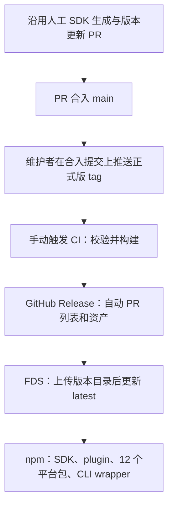

# 发版流程与分发边界

## Report

## [S1] Problem

**SDK 手动生成、版本更新 PR 的现行操作完全不变。** 本方案只把 PR 合入之后的 GitHub Release → FDS → npm 发布接入 tag 触发的 CI，并解除 MiMoCode 启动对同版本 plugin npm 包的隐式依赖。npm 排在 FDS 后面，尚未发布或发布失败时，已发布的 MiMoCode 仍须能正常使用内置功能。

本次交付包含发版 CI 与脚本、发版流程文档、Config/TUI 自动依赖准备链的删除，以及可运行的插件开发项目。用户要求 CI 写好但本次不启动发布：手动触发可用，稳定 tag 自动触发段保持注释。SDK 人工步骤不变；npm CLI 的约 v0.2.0 占位包仍是后续计划。

## [S2] Design

### 信息依据

- 现行人工操作以维护者本次说明为准：SDK 原本就手动生成，不需要前移、自动化或重新设计。
- **所有脚本分析以 MiMo-Code 主仓为准**，本次检查基线为 `f98dcd1c`。源码中存在的命令不等于维护者当前实际执行了整条命令。
- `mimoapi` 的所有文档和脚本均为历史资料。本次参考其环境注入、凭据分工及历史说明，不沿用它的脚本、路径、私有 plugin、overlay 或内部仓打 tag 步骤。最后一次发版之后已经有过一次面向开源可审计的大调整。
- Desktop 是独立的下游，按自己的 engine pin 随包编译。本次未找到其自动替换引擎的调用链，不新增 `desktop` channel，不安排 Desktop 修改。

### 修改前的主仓能力（分析基线）

| 项目         | 当前主仓事实                                                                                         | 对 CI 接入的意义                                             |
| ------------ | ---------------------------------------------------------------------------------------------------- | ------------------------------------------------------------ |
| CI 入口      | `.github/workflows/` 只有 main 的 typecheck、test、lint 及手动触发，没有 release workflow            | 新增稳定 tag 触发的发布流程；普通 main/PR CI 不承担发布      |
| 总发布脚本   | `script/release.ts` 顺序为 version → build → publish → undraft                                       | 不能把它原样塞进 tag job                                     |
| Release 描述 | `script/version.ts` 创建 draft，读 `UPCOMING_CHANGELOG.md`，不存在则写 `No notable changes`          | 新 CI 应使用 GitHub 自动生成的 PR 列表                       |
| 构建与上传   | `packages/cli/script/build.ts` 在 release 模式下同时打包、上传 GitHub、上传 FDS 并写 latest          | 需要让构建产物可复用，上传阶段可单独重试                     |
| npm 总入口   | `script/publish.ts` 遍历修改 package.json、调用非 frozen 安装、再次生成 SDK，再发布 CLI、SDK、plugin | 这些副作用不应进入新 CI；继续消费人工已提交的版本和 SDK 源码 |
| 包级发布     | `packages/{sdk,plugin,cli}/script/publish.ts` 已有打包/发布逻辑和“已发布则跳过”检查                  | 复用打包规则，由新的根入口协调正常发布顺序                   |
| FDS          | `script/fds-upload.ts` 提供对象上传和公开读 ACL 设置；build 在缺密钥时跳过 FDS                       | 正式发版不得把缺凭据静默当成功                               |
| 依赖安装     | `.github/actions/setup-bun/action.yml` 目前运行非 frozen 安装；build 还主动安装跨平台依赖            | 新 CI 必须按 `bun.lock` 准备依赖，不复制这些副作用           |

以上仅描述可调用代码。尤其 `publish.ts` 中的 SDK 生成是新 CI 必须避开的脚本行为，**不是对现行手动 SDK 流程的判断，也不是本方案要求改动 SDK 准备步骤**。

## [S3] Out of Scope

- 本次不启动 CI 发布、不修改 Desktop、不生成 SDK、不更新产品版本、不推送 tag、不上传或发布包；运行时仅修改 S6 的自动依赖准备及插件开发/调试路径。
- SDK 的人工生成流程保持原样；CI 不代替维护者生成或提交 SDK。
- 不执行 npm registry 的 deprecate 操作；本方案中明确标记 CLI 入口的弃用方向和阶段。
- 不引入 `desktop` channel，不把未复现的用户反馈定性为更新 bug。
- 不接入历史私有 plugin、overlay、内部仓构建或内部仓 tag。
- npm 下载 FDS 二进制的包装器仅比较方案，不作为已选实现。

## [S4] Tag 对应的发版流程

### 正常路径



本次保持旧的 **15 个 npm 包**：先 `@mimo-ai/sdk`，再 `@mimo-ai/plugin`，再 12 个平台二进制包，最后 `@mimo-ai/cli` wrapper。收敛成两个包的迁移只写在 S5，当前不切换发布范围。

这是低频、由维护者发起的发布流程。本次实现正常顺序和清晰失败，不实现自动跨渠道恢复、draft 备份、远端产物重建或通用竞态处理。

### 如何触发

1. 将本次 workflow 和发布脚本合入 main；旧 tag 不含这些文件时不能使用新流程。
2. 配置下文的三个 repository secret。
3. SDK 手动生成、版本更新 PR 和合入操作照旧。在合入提交上创建并推送正式版 tag，不在发布过程中补版本或生成 SDK。
4. 在 **Actions → release → Run workflow** 选择 main，填写已有 tag。等价命令：`gh workflow run release.yml --ref main -f tag=v0.1.99`。这里是示例版本，本次未执行。
5. `push.tags: ['v*.*.*']` 已写在 `release.yml` 中，但保持注释。以后决定启用时再取消注释并合入；当前推 tag 本身不会启动发布。

用户已确认首版仅支持 `vMAJOR.MINOR.PATCH` 正式版，拒绝预发布、构建后缀、前导零和缺段版本。glob 只是事件筛选，手动和自动入口都执行正式版本校验。

### 构建输入与检查

- 获取完整 tag/main 历史，解引用 tag 并检查提交属于 `origin/main`；全部检查和构建固定该 SHA，不再追随当时最新的 main。
- tag 去掉 `v` 后，必须与 CLI、SDK、plugin、shared 的 package.json 及 `bun.lock` workspace 版本一致。根 package.json 无版本，不新增。拒绝版本 bump 或跳过校验的环境变量。
- 复用现有 typecheck、lint、分片及隔离测试；发布脚本测试也接入常规 test workflow。不能只依据 PR 合入前的检查。
- 按 packageManager 固定 Bun，依赖用 `bun ci`；跨平台构建用 `bun ci --os='*' --cpu='*'`，随后 CLI build 使用 `--skip-install --archive`。CLI 构建本身不上传。
- SDK 只用 TypeScript 编译已提交源码，**不调用会重新生成 SDK 的 build 脚本**；不改版本、锁文件或生成提交。构建结束检查源码仍干净。
- 单次构建保存一份 models.dev 快照供全部目标使用。版本、SHA、文件清单和本地摘要写入 `dist/release/manifest.json`，与压缩包、npm tarball、快照一起交给发布 job。清单用于检查 job 之间拿到正确且完整的本次构建产物，不承担远端恢复协议。

### 四个脚本阶段

统一入口是 `bun script/release.ts --stage build|github|fds|npm`，版本通过 `MIMOCODE_VERSION` 输入，channel 固定 `latest`。`--dry-run` 只做预检/已有产物校验，不表示完成构建或上传。

| 阶段   | 行为                                                                                                                                                    |
| ------ | ------------------------------------------------------------------------------------------------------------------------------------------------------- |
| build  | 编译 12 个 CLI 目标，生成原有命名/压缩格式的二进制归档；编译并打包 SDK、plugin，组装 12 个平台 npm 包和 CLI wrapper；输出到 `dist/release/`             |
| github | 使用 `gh release create --verify-tag --generate-notes` 和本次资产路径创建完整 Release；PR 列表及比较范围交给 GitHub 生成，不手写 draft 查询和恢复状态机 |
| fds    | 上传相同 CLI 归档到 `releases/v<version>/`，全部上传成功后再将 `releases/latest` 写为裸版本号                                                           |
| npm    | 从本次构建的 tarball 按 SDK → plugin → 平台包 → wrapper 顺序发布，使用 npm `latest`；wrapper 所依赖的平台包先发布                                       |

保留一个发布 job 的互斥，避免维护者同时启动的版本交错执行三段发布。维护者仍应逐个发版，不将 Actions 的 pending 槽当作发布队列，不用旧版本作正常 latest 发布。

GitHub/FDS 可以先于 npm 可用，npm 失败不会撤回它们。S6 已解除内置功能对同版本 plugin npm 包的运行时安装依赖，所以这一时间窗口不再要求 npm 同步完成。

旧的包级 publish 和 draft-only version 入口给出迁移提示并退出，避免一个看似只发布 SDK 的旧命令意外发布整组包；根 release 入口负责协调发布。npm CLI 的范围仍保持原样。

### Secrets 与环境变量

在仓库 **Settings → Secrets and variables → Actions** 配置：

| 类型                      | 名称                                                      | 用途                                                                                           |
| ------------------------- | --------------------------------------------------------- | ---------------------------------------------------------------------------------------------- |
| 必需 secret               | `MIMO_FDS_AK`                                             | FDS access key；需要对象写入和公开读 ACL 设置权限                                              |
| 必需 secret               | `MIMO_FDS_SK`                                             | 上述 access key 的 secret                                                                      |
| 必需 secret               | `NPM_TOKEN`                                               | 支持无人值守发布，覆盖当前全部 15 个 npm 包的写权限                                            |
| 自动提供                  | `GH_TOKEN`                                                | workflow 从 Actions 自带 `github.token` 注入，发布 job 声明 `contents: write`；无需另建 secret |
| 自动提供                  | `NODE_AUTH_TOKEN`                                         | npm 步骤从 `NPM_TOKEN` 映射；setup-node 配置 registry/npmrc，不能只设置一个 npm 不读取的变量   |
| 自动提供                  | `GH_REPO`、`MIMOCODE_VERSION`、`MIMOCODE_CHANNEL`         | 分别来自当前 GitHub 仓库、已校验 tag、固定的 `latest`                                          |
| 可选 repository variables | `MIMO_FDS_ENDPOINT`、`MIMO_FDS_BUCKET`、`MIMO_FDS_PREFIX` | 覆盖上传目标，未提供时用主仓脚本默认值                                                         |

发布前检查三个 secret 非空，避免缺配置时先公开 Release。非空不代表权限或网络一定可用；实际上传失败会直接报错。无需开发者机器的 `.env`、私人 npmrc、内部仓权限或私有 plugin。调整 FDS 上传目标时，维护者须同时确认它仍与安装器实际使用的下载地址/布局一致；下载端的 `MIMO_FDS_BASE` 不是本次 CI 的凭据。

### 失败时由维护者处理

- 某阶段失败就停止，不继续后续渠道。Actions 保留本次构建 artifact，日志指出失败命令。
- 若还未写入任何外部渠道，处理原因后重新运行即可。
- 若 GitHub 已创建或上传了一部分资产，先检查 Release 状态；必要时清理本次未公开的残留 draft，再使用原始构建产物继续。脚本不自动替换已公开资产，也不自动重建远端清单。
- 若 FDS 或 npm 已部分成功，从原始构建产物继续未完成部分。npm 已发布的版本不能覆盖；维护者确认哪些包成功后，仅补发缺失包，不能盲目从头重发 15 个包。
- 不因 npm 失败回滚已经可用的 GitHub/FDS，也不删除已有 npm 版本。若产物内容本身有错，准备新的修复版本。

本次不启动真实发布。全平台编译、真实凭据权限与云端上传由维护者后续手动触发时验证；本地验收覆盖流程配置、输入/产物检查、打包和主机二进制冒烟。

## [S5] npm CLI 入口弃用

**决定：npm 的 CLI 安装入口进入弃用计划；长期仅维护 `@mimo-ai/sdk` 和 `@mimo-ai/plugin` 两类开发包。** CLI 本身继续作为 GitHub/FDS 二进制分发，不废弃 `mimo` 命令或核心产品。本次只在方案中标记弃用，未修改 npm registry 状态。

**本 PR 保留旧的 15 包发布范围。** 后续收敛时，单独提交迁移 PR：从 build/npm 的包清单移除 CLI wrapper 和 12 个平台 npm tarball，保留全部 CLI 二进制归档供 GitHub/FDS 使用；相应调整 manifest 检查与测试、镜像同步清单和 `NPM_TOKEN` 包权限，使 npm 只发布 SDK/plugin。CLI 占位包或下载引导方案先在该后续任务中确定，不在这里实现或按版本号自动切换。

| 阶段          | CLI npm 行为                                                                                                           | 必须先满足                                                                   |
| ------------- | ---------------------------------------------------------------------------------------------------------------------- | ---------------------------------------------------------------------------- |
| 0.1.x 过渡    | 暂保留现有 CLI wrapper 和平台包发布；文档/发版说明引导改用官方安装器，实施迁移时为这些 CLI 包设置 npm deprecation 提示 | 明确公告，验证现有 npm 用户迁移到官方安装目录后的 PATH 和升级路径            |
| 目标约 v0.2.0 | 为 `@mimo-ai/cli` 发布一次只含 package.json、README、LICENSE 的占位包；停止平台 npm 二进制包的新版本发布               | 在该版本准备 PR 中确认迁移已完成；未满足就推迟占位包，不能自动按版本阈值切空 |
| 后续稳定版本  | npm 正常发布白名单只含 SDK、plugin；占位包不必每版跟随                                                                 | 发布脚本与镜像同步脚本均不再遍历 CLI 平台包                                  |

占位包没有 `bin`、安装脚本、运行代码、dependencies 或 optionalDependencies。README 和 npm deprecation 提示推荐从 [MiMoCode 官方安装说明](https://mimo.xiaomi.com/coder)安装二进制；不要在 postinstall 中自动执行下载器。已有 CLI/npm 平台版本保留，不做 unpublish。该占位版本也应有 registry deprecation 提示。

需要明确告知用户：显式把全局 npm CLI 升到占位版本会移除原有命令入口，不能把这当成无影响更新。当前自动升级只应用被判为 patch 的版本，但用户仍可能手动 upgrade/npm update；占位包必须先公告迁移。迁移先安装并验证官方二进制，再移除旧 npm 安装并检查命令解析位置；SDK 的 `createOpencode` server helper 也会通过 PATH 启动 `mimo`，其使用者仍需单独安装 CLI。

SDK/plugin tarball 检查应证明：包内导出路径实际存在、`workspace:*` 和 `catalog:` 已转换为可公开解析的依赖、plugin 指向本次准备的 SDK 版本，两个包的说明分别解释 API/插件用途。当前两者复制同一份 CLI 导向的 `README_npm.md`，后续应拆成各自说明，避免继续推荐已弃用的 npm CLI 入口。

“npm wrapper 下载 FDS 二进制再启动”暂不采用。它仍需要维护平台/ABI 选择、下载校验、缓存、代理、PATH、卸载和版本固定；当前升级器还会按 npm 安装路径走 npm feed，与直接下载二进制的更新归属不一致。只有决定继续维护 npm CLI 入口时，才值得单独设计这条路径。

## [S6] 为什么会调用 npm，以及如何不依赖它启动

### 修改前的调用链

```text
Config.loadInstanceState（普通配置目录，非 modelsOnly）
  或 TuiConfig.layer（配置了外部 TUI plugin 时）
  → Npm.install(dir, { add: [{ name: "@mimo-ai/plugin", version }] })
  → import("@npmcli/arborist")
  → Arborist.reify({ add, save: true, saveType: "prod" })
  → 配置目录中的 package.json / package-lock.json / node_modules
```

修改前基线的 [Config](../../../packages/cli/src/config/config.ts) 有后台安装，[TUI Config](../../../packages/cli/src/cli/cmd/tui/config/tui.ts) 有依赖准备，两者调用 [Npm 实现](../../../packages/cli/src/npm/index.ts)。这里使用的是 npm 的 JS 库 `@npmcli/arborist`，**不要求调用系统的 npm 可执行文件**。它负责解析、下载和落盘依赖；`ignoreScripts: true` 只是不运行安装脚本，不表示不会联网。

自动补装的作用是给用户配置目录中直接加载的插件/工具源码提供模块解析环境。它不是“插件系统必须先从 npm 下载才能存在”。普通 Config 即使没有外部插件也会安排安装；TUI 只在其外部 plugin 配置非空时安排。安装失败可能只留下警告，并不保证所有内置功能因此失败，但会产生无必要的下载和本地插件解析问题。

修改前的安装身份解析对合法 release semver 请求同版本 SDK；本地或非 semver 身份不固定版本。因此 FDS 先公开一个尚未发 npm 的版本时，干净目录可能请求尚不存在的 `@mimo-ai/plugin@<version>`。已有缓存可能掩盖问题，不能用开发机“启动正常”证明发版顺序安全。

### 哪些已经内置

| 能力                                                          | 当前来源                                                                | 是否需要启动时补装 plugin npm 包               |
| ------------------------------------------------------------- | ----------------------------------------------------------------------- | ---------------------------------------------- |
| 插件管理、hook 执行、工具注册                                 | 引擎源码的 plugin、tool registry、TUI runtime                           | 不需要                                         |
| 官方内置插件                                                  | 服务端 `INTERNAL_PLUGINS` 静态导入；TUI `INTERNAL_TUI_PLUGINS` 静态导入 | 不需要；第三方源码依赖也是构建时依赖           |
| 宿主用到的 SDK 运行值                                         | 例如 matcher 导入 `BUILT_IN_AGENTS`、宿主创建 SDK client                | 通过 workspace 依赖进入 CLI/Node 构建          |
| 用户松散源码插件中的 `import { tool } from '@mimo-ai/plugin'` | 运行时从该源码所在目录解析模块                                          | 目前受隐式安装帮助；应改为开发者自行准备或打包 |

`@mimo-ai/plugin` 并非纯类型包：它导出 `tool()`、`tool.schema`（Zod）和 `BUILT_IN_AGENTS` 等运行值；`/tui` 当前主要提供类型。简单把所有 import 改成 `import type` 不成立，也无需复制一份插件系统进核心。所需核心功能已经在构建依赖图里。

### 本次实现边界

1. **取消 Config/TUI 的自动目录依赖准备链路**，不再注入 plugin SDK、不按引擎版本联网补包。只删除 `add` 参数仍会恢复旧清单依赖，因此不足以满足这条边界；对应等待和文件加载重试链也要一起检查。
2. 内置插件继续静态导入并随 CLI/Node 产物分发；未来官方插件如果属于产品必备功能，遵循同样方式。不开启默认 npm 插件清单来替代内置。
3. 插件/自定义工具开发者自行取得开发依赖。类型使用 `import type`；实际用到的 runtime helper、业务依赖打进分发产物，或由开发者明确准备本地依赖。漏依赖时给出可定位的模块错误，不静默补装。
4. TUI 插件不能无差别内联所有依赖：Solid/OpenTUI 的宿主共享运行时保持 external，由现有 `@opentui/solid/runtime-plugin-support` 桥提供，避免 renderer、owner、signal/store 出现两份实例。普通业务依赖和 SDK helper 才是可打包部分。
5. 不自动删除旧配置目录中的 package.json、锁文件或 node_modules，无法可靠区分它们由谁维护。停止 bootstrap 后不再主动恢复其中的 SDK；旧的松散插件仍可用既有依赖，开发者按自身需求迁移或清理。
6. 保留用户明确配置的 npm 插件按需安装：`resolvePluginTarget → Npm.add` 是独立路径。插件自己声明的传递依赖仍可能包含 SDK，这是该外部插件的分发选择，不应变成 MiMoCode 内置功能的依赖。

迁移说明放在 `docs/plugins.md`，中英文 README 增加开发插件的 details，默认推荐打包式分发。提供 `examples/plugins/greeting` 开发项目，包含公开 SDK 开发依赖、类型检查、build、watch 和部署说明；用户在自己的项目初始化锁文件，后续用 frozen 安装。

用 `mimo debug agent build --tool greet --params '{"name":"Example"}'` 直接验证注册工具，结果为 `Hello, Example!`。调试入口使用完整的已注册工具集合，保留 model/agent/permission 过滤但不应用 GPT 顶层工具压缩，先按工具 schema 解析参数，再通过 AppRuntime 执行 Effect。错误参数必须在执行前失败，不能返回 `Hello, undefined!`。

缺少运行依赖的本地插件保留原始模块错误，并给出“自行准备依赖或打包后加载”的可操作提示；不对所有用户增加启动弹窗。已有自包含插件、内置插件及显式 npm 插件安装方式不变。

不建议为所有第三方源码额外实现“将 `@mimo-ai/plugin` 重定向到宿主模块”的透明加载器。它需要同时处理 Bun 编译 CLI、Node ESM、包子路径、版本兼容和 TUI 共享实例，范围远大于取消自动 bootstrap，也不符合开发者自行打包的方向。

**不删除整个 Npm 服务。** 主仓还有非内置 provider 的 `Npm.add(model.api.npm)`，以及 formatter/LSP 的 `Npm.which()`（缓存缺失时会安装）。已内置 provider 走 `BUNDLED_PROVIDERS`，不用这条动态安装路径。本方案保证“内置插件和默认运行不依赖 plugin npm 包”，不承诺所有外部插件、provider、语言工具或模型服务都无需网络。

本次实现取代 [plugin-sdk-npm-version](plugin-sdk-npm-version.md) 中“继续自动安装但修正 npm 版本选择”的运行时策略；那份文档保留为历史交付记录。删除失去调用方的 `PluginSdkNpmVersion`，安装身份本身仍供其他功能使用。

## [S7] Desktop 核查结论

检查 Desktop `2955b9ad` 及其 engine pin `6babeb0b`：`scripts/engine/build-engine-node.ts` 将 `desktop-<pin7>` 和 `channel=latest` 注入 Node 构建；`electron.vite.config.mjs` 将产物拷为 `node.mjs`，`electron/lib/engine/index.ts` 在 Electron 主进程中动态导入并调用 `Server.listen`。它并非启动独立的 `mimo` 二进制。

主仓自动升级链为 `tui/thread.ts → worker.checkUpgrade → cli/upgrade.ts`。在检查的 Node 入口及 Desktop 中未找到这条自动调用，也未找到 Desktop 调用 `/global/upgrade` 的代码。非 semver 的 `desktop-<pin7>` 若误入版本分类，目前还会被 semver 拒绝；这不作为正式保护设计。

`/global/upgrade` 接口确实存在，且未用 channel 区分更新归属，但“可调用接口”不能证明用户报告的事件已经发生，更不能证明它替换了内嵌 Node 产物。**按本次决定跳过 Desktop 修改，不新增 desktop channel。** 后续只有拿到具体版本、调用日志及被改文件证据，再按真实触发原因调查；Desktop 自身的整包 updater 不受本方案影响。

## [S8] 后续实现顺序与验收

本次交付覆盖运行时修改和 CI 代码；真实 GitHub/FDS/npm 发布由维护者之后手动启动。完成情况以 Report 为准，不能把本地测试写成已上线发布。

| 顺序      | 工作                                   | 验收条件                                                                                                                                                         |
| --------- | -------------------------------------- | ---------------------------------------------------------------------------------------------------------------------------------------------------------------- |
| 1（本次） | 解除自动 plugin SDK 安装并提供迁移指引 | 干净配置、旧自动生成清单、开发者自备依赖三类环境；普通 Config/TUI 加载不再需要 Npm 安装服务；保留自包含插件、内置插件和显式 npm 插件功能；缺依赖的文件插件有引导 |
| 2         | 固定发布输入并拆开脚本副作用           | 保持 SDK 人工步骤原样；CI 只编译已提交内容；版本/锁/tag 不一致即失败，全部目标及 tarball 生成后源码仍干净                                                        |
| 3         | 接入 tag workflow                      | 合法 main 稳定 tag 触发，非法 tag/非 main 提交不能发布；检查完成后依次 GitHub → FDS → npm，notes 范围正确                                                        |
| 4         | 验证 npm 延迟与失败处置                | 在无对应 npm SDK 的环境中，从已构建二进制加载内置能力和自包含插件；发布命令失败停止，文档明确部分成功后的人工处理，不要求自动恢复                                |
| 5         | 公告 npm CLI 迁移                      | README、Release notes 和 registry deprecation 文案一致；在目标约 v0.2.0 的准备 PR 确认占位策略，tarball 无 CLI 内容，SDK/plugin 发布持续可用                     |

本次插件验收使用真实服务端插件构建产物和隔离配置目录，覆盖打包的 `tool`/Zod、缺依赖提示和参数校验；配置层在不提供 Npm 服务的情况下运行，不能靠 noop Npm mock 得出“不联网”。TUI 复用已有加载、安装、生命周期测试；没有交付新的 JSX 构建器或声称已做编译后 Solid 界面验收。未来提供 JSX 插件开发项目时，再验证实际 slot 渲染、响应式更新和 cleanup。默认内置 provider 可使用本地测试服务，避免把模型服务网络失败误判成插件问题。

CI 本次验收包括 workflow 语法、触发/权限/依赖关系、tag 与本地产物校验、GitHub 命令参数、15 个 npm 包的顺序及命令失败停止；不调用真实写入 API。首次启用后再验证全平台构建和真实云端发布。

## 参考

- 当前主仓：[release](../../../script/release.ts)、[version](../../../script/version.ts)、[publish](../../../script/publish.ts)、[CLI build](../../../packages/cli/script/build.ts)、[FDS uploader](../../../script/fds-upload.ts)、[SDK build](../../../packages/sdk/script/build.ts)、[npm 包级发布](../../../packages/plugin/script/publish.ts)、[CI setup](../../../.github/actions/setup-bun/action.yml)。
- 内置来源：[服务端插件](../../../packages/cli/src/plugin/index.ts)、[TUI 插件](../../../packages/cli/src/cli/cmd/tui/plugin/internal.ts)、[插件 helper](../../../packages/plugin/src/tool.ts)、[工具注册](../../../packages/cli/src/tool/registry.ts)、[provider](../../../packages/cli/src/provider/provider.ts)、[Node 构建](../../../packages/cli/script/build-node.ts)。
- 历史资料，仅辅助理解：[github-release.md](https://git.n.xiaomi.com/mimo-innovation/mimoapi/-/blob/3b6a8f62092c496af2778d7ffc213d9e4f73cc19/docs/github-release.md)、[release-handover.md](https://git.n.xiaomi.com/mimo-innovation/mimoapi/-/blob/3b6a8f62092c496af2778d7ffc213d9e4f73cc19/docs/release-handover.md)、[npm-publish.md](https://git.n.xiaomi.com/mimo-innovation/mimoapi/-/blob/3b6a8f62092c496af2778d7ffc213d9e4f73cc19/docs/npm-publish.md)。不据此推断当前主仓行为。

## Tasks

- [ ] T1: 形成 PR → tag → CI 流程 — acceptance: 主仓为脚本依据，SDK 人工流程不变，写清自动 notes、发布顺序、凭据和人工失败处置 (covers: S2,S4)
- [ ] T2: 明确 npm CLI 弃用 — acceptance: 约 v0.2.0 占位包、迁移前置条件与 SDK/plugin 保留范围可审查 (covers: S5)
- [ ] T3: 分析 npm JS 调用及内置功能边界 — acceptance: 说明 Arborist 调用原因、已内置能力、去除 bootstrap 的范围，以及 npm 尚未发布时的运行验收 (covers: S6,S8)
- [ ] T4: 核查 Desktop 反馈 — acceptance: 提供下游真实构建/调用证据，未发现自动触发则不新增 channel、不设修复任务 (covers: S7)
- [ ] T5: 校验并独立审查交付 — acceptance: 相关测试、类型检查、文档和差异检查通过，独立审查覆盖事实、行为和约定，Report 记录证据 (covers: S2; depends: T1,T2,T3,T4,T6,T7,T8,T9)
- [ ] T6: 删除 Config/TUI 自动安装及等待链 — acceptance: 无需 Npm 安装服务即可加载两类配置，不生成或恢复 SDK 依赖，删除死版本选择器，保留显式 npm 加载 (covers: S6,S8; depends: T3)
- [ ] T7: 添加回归验证和可运行插件开发项目 — acceptance: 自包含插件可加载，现有清单保留，缺依赖提示正确；中英文 README details 可发现开发/构建/部署说明；普通及 Codex 工具模式均能通过 debug 命令实际执行示例 (covers: S6,S8; depends: T3)
- [ ] T8: 实现分阶段发布脚本 — acceptance: build/github/fds/npm 消费同一份本地产物清单，build 不改版本或生成 SDK，GitHub 自动生成描述，FDS 后发布旧范围 15 个 npm 包，失败明确停止，单测不调用真实发布 API (covers: S4,S5,S8; depends: T1)
- [ ] T9: 实现发布 workflow 与 secret 接口 — acceptance: 手动输入已有正式 tag；自动 tag 段保持注释；校验/测试固定 tag SHA；发布前检查三个 secret，GitHub/FDS/npm 顺序执行且共用发布互斥；静态校验通过 (covers: S4,S8; depends: T1,T8)
