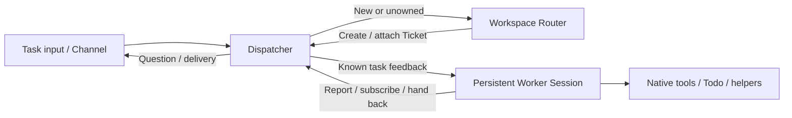
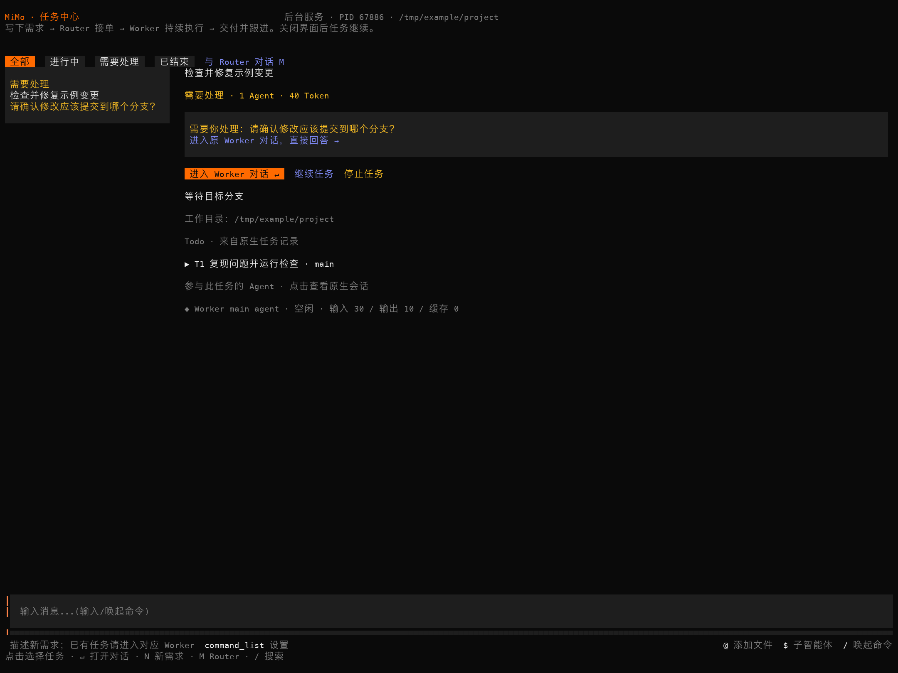
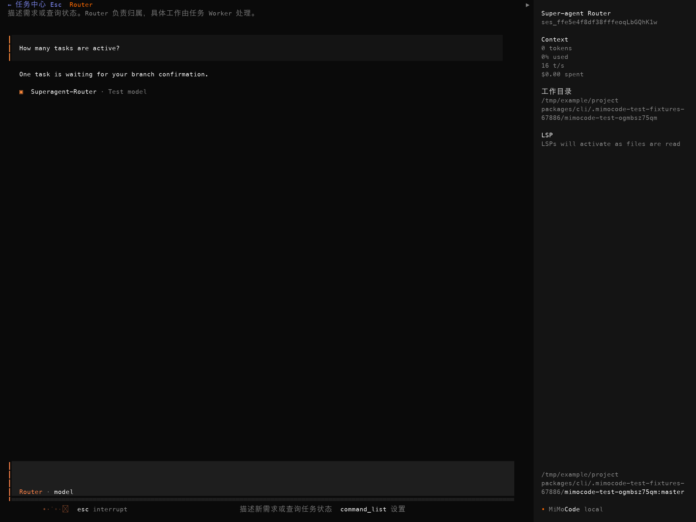
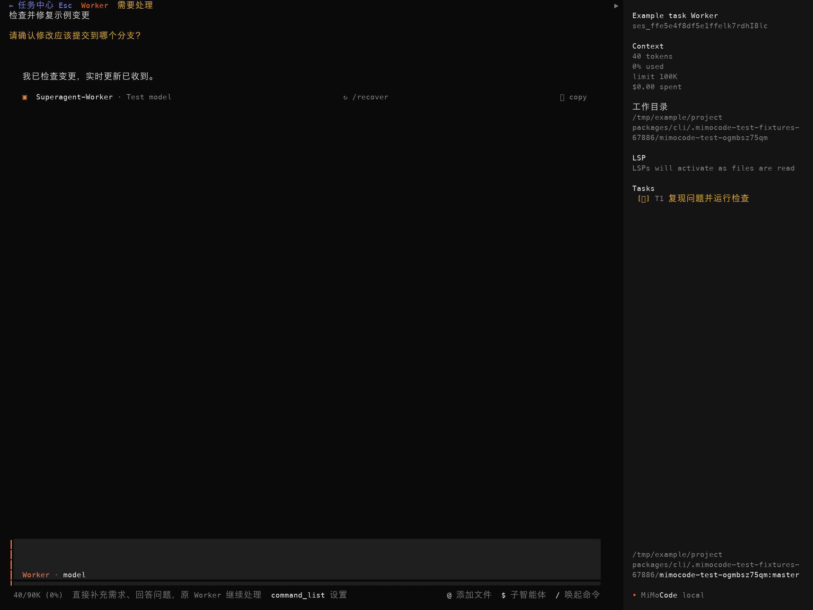

# Super-agent

A workspace has one Router. Each Ticket owns one native Worker Session. Dispatcher persists input, task/thread ownership and deliveries. A detached MiMo Server owns execution independently of the UI.

## Problem and design boundary

Use this when several requests must continue independently: implement a GitHub change, respond to its later review, and work on an unrelated document without mixing their implementation contexts. The primary gains are persistent ownership, parallel task intake, continuity across channels and a clear place to supervise work. A separate UI should not own task execution, and a new chat should not force the user to reconstruct the correct Worker context.

The Router keeps intake/routing conversation and concise workspace task cards. Worker transcripts and tool output are not automatically copied into it. A Ticket is a durable task record, not another model loop. It keeps its original Worker Session and worktree. Multiple independent Tickets produce multiple Workers; a Worker can use native helpers for useful parallel investigation/implementation within its own task. Small tasks do not need a plan-registration ceremony or mandatory helpers.

The user's request determines intent. Router records a faithful initial goal and routes it. Worker investigates the technical details and asks one concrete question when a missing decision blocks useful work. Detailed acceptance is refined with the user in that task's native conversation and Todo, rather than a required intake form or Router-prescribed implementation.

Worker self-review uses actual files, checks and deliverables. An independent Verifier is not part of this core. This structure does not by itself prove higher delivery quality or lower token use than ordinary Build; the new implementation needs its own frozen benchmark comparison.

## Start and use

```sh
cd /tmp/example/project
mimo
```

From this source checkout with dependencies installed, use `bun dev /tmp/example/project`. The task center opens directly; no separate `serve` or `attach` is required. Write one natural-language request and send it. Router answers greetings/status or creates/associates a task. Detailed clarification, planning, Todo, helpers, implementation and checks belong to its Worker.

Select a task to see its state, actual Todo, Agents, usage, working directory and artifacts. Open its Worker to answer a question or follow up. Esc returns to the task center. Router, Worker and helper transcripts use the complete existing Session screen, including live output, tools and native permission/question controls. Helpers retain native transcript/input behavior. The task center input starts new requests; follow up inside an existing task's Worker to preserve context. Explicit references can be associated by Router; topic similarity alone is insufficient.

`/super-agent` and compatibility alias `/superagent` open the same task center from an ordinary conversation. Explicit `--session`, `--continue` or `--agent` startup retains the ordinary Session entry. The selected native model is passed with local input.

```sh
mimo daemon status
mimo daemon stop
mimo daemon start
```

The authenticated loopback daemon is reused per canonical project directory. Closing the UI disconnects that client; work continues. `daemon stop` interrupts native execution. Restart resumes interrupted tasks in the original Session with an instruction to inspect existing work before repeating external actions. A human-stopped task requires explicit Continue. There is no installed OS service; after a crash, the next launch restarts the daemon. Use existing `mimo serve`/`mimo attach` for custom network listeners. After editing Server source, stop that project's daemon before restarting; from this checkout use `bun dev daemon stop /tmp/example/project`.

## Responsibilities



| Component  | Responsibility                                                                                                                                                                          |
| ---------- | --------------------------------------------------------------------------------------------------------------------------------------------------------------------------------------- |
| Router     | Ownership and minimal routing clarification; status and communication. Tools: `superagent_read`, `superagent_route`, `superagent_reply`.                                                |
| Dispatcher | Durable inputs, per-delivery deduplication, task/thread bindings, scheduling, reply queue, stop/resume and recovery. No implementation planning.                                        |
| Worker     | Clarify technical goals, plan substantial work, use useful helpers, implement, check and deliver using native Build tools. Additional tools: `superagent_report`, `superagent_threads`. |
| Daemon     | MiMo Server and Dispatcher lifecycle, independent of UI clients.                                                                                                                        |
| Channel    | Authentication, identity, mentions, thread normalization and replies.                                                                                                                   |
| UI         | Fast intake and task management; native Sessions for conversations.                                                                                                                     |

Git tasks use native worktrees based on current committed HEAD; uncommitted source edits are not copied automatically. Other tasks use persistent task directories. The original workspace is included in the brief. Artifacts remain in the displayed work directory; requested commits/PRs are delivered by the Worker. Changes are not silently applied to the source checkout.

`MIMOCODE_SUPERAGENT_MAX_WORKERS` defaults to 3 active Tickets. No extra token budget, forced decomposition, mandatory helpers or independent Super-agent round counter is added. Normal model, permission and per-Agent step settings still apply.

### Example: GitHub and Feishu at the same time

1. An allowed user mentions the GitHub bot in an Issue and asks for a PR. Channel normalizes account, event and issue thread; Router creates a Ticket; Dispatcher starts Worker A.
2. Worker A investigates, uses native Todo/helpers as useful, changes code, runs checks and opens the authorized PR. It registers that PR as a deliverable subscription and reports ready. The Ticket stays in Review while the PR remains open.
3. A review asks for a bug fix. The subscribed PR thread sends feedback directly to Worker A's original Session/worktree; another Router model call is unnecessary. A revised report cannot accept a stale earlier revision.
4. In an allowed Feishu chat, an unrelated request asks for a document or data analysis. It creates another Ticket and Worker B, which can work alongside A with an independent conversation. Questions and important results return to the original Feishu topic.
5. A known-topic follow-up continues its existing task even without repeating the mention. An unowned request requiring clarification stays with Router until ownership is clear. Unrelated input received by a Worker can be handed back with a reason.
6. A person closes the UI: the daemon keeps working. Reopening shows the same tasks and native Agent conversations. Stopping a Ticket prevents bot-triggered automatic resumption; continuing it is an explicit user action.

## State and delivery

- Queued: waiting for execution capacity.
- Working: native execution is active; native questions/permissions identify the required user action.
- Needs attention: concrete Worker blocker/error. Open its original conversation to respond or inspect it.
- Waiting: yielded for a future event or ended without a delivery report. Idle does not imply successful delivery.
- Delivered: accepted Worker `ready` report with actual checks/artifacts. This is self-review, not an independent correctness guarantee.
- Review: a subscribed PR is still open. Reviews/CI return to the original Worker; merge/closure completes it when current work is ready.
- Stopped: a human stopped the task; bots cannot restart it.

Ready rejects stale revisions, unfinished published Todo, active required helpers and other running tools in the same batch. Human feedback can reopen delivered work in the same Session. Unrelated input can return to Router. Multiple tasks can subscribe to one thread; each receives an event once.

The core has no independent Verifier/candidate/check state machine, duplicate planner, custom Bash job engine or alternate chat renderer. Native Bash/Actor behavior remains. Legacy Tickets and Session history remain readable; historical actions are retained and never replayed automatically. Explicitly continue a legacy task to adopt the new flow.

## Channels and API

Set `MIMOCODE_SUPERAGENT_CHANNELS` to a JSON file before daemon startup; restart after changes. Entries are scoped to the daemon's workspace:

```json
[
  {
    "kind": "github",
    "id": "example-github",
    "directory": "/tmp/example/project",
    "repository": "example/project",
    "allowedSenders": ["example-user"]
  },
  {
    "kind": "feishu",
    "id": "example-feishu",
    "directory": "/tmp/example/project",
    "cli": "lark-cli",
    "botId": "example-bot",
    "appId": "example-app",
    "allowedSenders": ["example-user"],
    "chats": ["example-chat"]
  }
]
```

GitHub uses authenticated `gh` polling: `@<authenticated login>` addresses new requests; issue/PR comments, inline reviews, CI snapshots and closure become stable events. Feishu uses an already configured `lark-cli` event stream: direct messages or actual mention IDs address the bot; the message/topic root identifies its thread. Configured senders and repository/chat scopes are enforced. Adapter tests cover transport contracts; deployment needs actual service credentials and configuration.

Another integration implements `ChannelAdapter` in `packages/cli/src/superagent/channel.ts`, normalizes events to `ChannelInput`, and registers workspace/sender/thread scope. Channel owns transport; Dispatcher owns tasks. Context subscriptions grant no write authority. Replies use durable action IDs. Interrupted idempotent deliveries can retry; uncertain non-idempotent deliveries require inspection before explicit retry.

| Method | Path                                     | Purpose                                                           |
| ------ | ---------------------------------------- | ----------------------------------------------------------------- |
| GET    | `/superagent`                            | Tasks, native Todo/Agents, usage, questions and delivery problems |
| POST   | `/superagent/master/inputs`              | New Router input; compatibility API name                          |
| GET    | `/superagent/tickets/:ticketId`          | Task and activity                                                 |
| POST   | `/superagent/tickets/:ticketId/inputs`   | Feedback to original Worker                                       |
| POST   | `/superagent/tickets/:ticketId/actions`  | `cancel` or `resume`                                              |
| POST   | `/superagent/deliveries/:actionId/retry` | Explicit delivery retry                                           |
| GET    | `/superagent/channels`                   | Channel health                                                    |

Input mutations require `Idempotency-Key` and the project's `directory` parameter. Body: `{"text":"...","attachments":[],"model":{"providerID":"test","modelID":"model"}}`; attachments/model are optional. A daemon executes tasks only for its owned project. Existing Server authentication/directory restrictions remain, with access to that project's persisted worktrees.

## Validation

`bun test test/superagent` covers durable state, Channel normalization, the real task HTTP entry through Router/native Inbox/Worker, delivery and same-Session revision, native UI navigation/streaming and detached subprocess startup/reuse/restart. Deterministic tests establish lifecycle behavior. Earlier frozen quality benchmarks do not establish delivery-quality gains for this refactor.

The following captures use the complete production TUI with deterministic fixture records and a controlled local model response. Paths are anonymized; these are interaction/lifecycle demonstrations, not benchmark-quality evidence.






